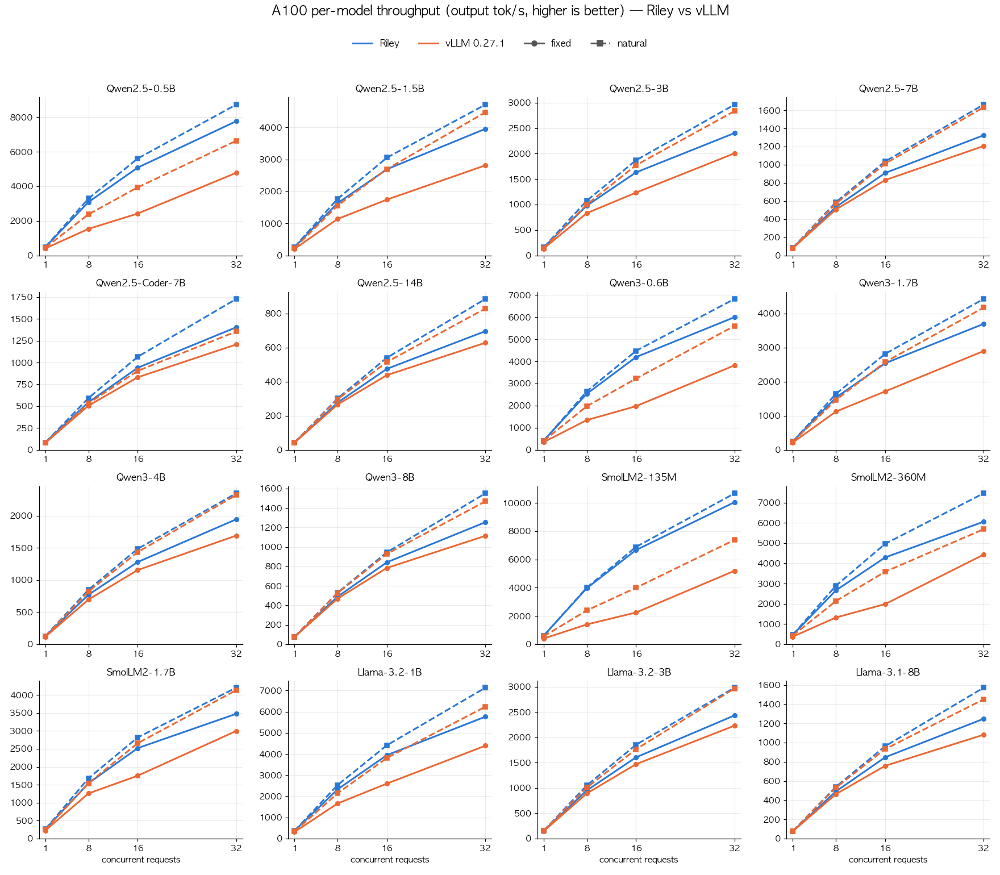

# Riley

**A Rust-native LLM inference server for a single NVIDIA GPU — higher
throughput and lower time to first token than vLLM 0.27.1 on all 16 qualified
models.**

Riley (Rust Inference LLM Engine) serves Llama- and Qwen-style models over an
OpenAI-compatible completions API. The server, scheduler and KV-cache manager
are Rust; the arithmetic runs in ahead-of-time compiled CUDA kernels and
cuBLASLt. There is no Python in the serving process.

> Status: pre-release (0.1.0 release candidates). Results below are BF16,
> greedy decoding, one GPU; they are model- and workload-specific.

## Performance

**16 models on one A100-SXM4-40GB, against vLLM 0.27.1 on the same GPU in the
same run:**

| | Riley vs vLLM |
|---|---|
| **Throughput** at 8–32 concurrent clients | **higher in all 96 cells — 1.01× to 2.97×** |
| **Time to first token** (p50) | **lower in all 128 cells — 1.1× to 8.2× faster** |
| **Time per output token** (p50) at 8–32 clients | lower in 94 of 96 cells |
| One client | within ±3 % (tie) to 1.5× faster on throughput |
| **Output** | identical tokens for a request whatever else is in the batch |



Blue is Riley, orange is vLLM; solid lines are fixed-length output, dashed
lines natural-length output. Each panel has its own y-axis scale.

Concurrency 32, fixed-length output (Riley / vLLM):

| Model | Throughput tok/s | Speed-up | TTFT p50 ms | TPOT p50 ms |
|---|---:|---:|---:|---:|
| SmolLM2-135M | **10048** / 5194 | **1.93×** | **8.6** / 57.0 | **2.37** / 3.05 |
| Qwen2.5-0.5B | **7767** / 4780 | **1.62×** | **9.6** / 54.6 | **3.22** / 3.77 |
| Qwen3-0.6B | **5999** / 3821 | **1.57×** | **12.1** / 48.4 | **4.18** / 5.62 |
| Qwen2.5-1.5B | **3957** / 2816 | **1.41×** | **19.2** / 45.6 | **6.49** / 8.50 |
| SmolLM2-360M | **6058** / 4429 | **1.37×** | **12.9** / 61.3 | 4.08 / 3.94 |
| Llama-3.2-1B | **5767** / 4393 | **1.31×** | **12.8** / 38.2 | **4.41** / 5.10 |
| Qwen3-1.7B | **3693** / 2897 | **1.27×** | **20.2** / 44.2 | **6.87** / 8.33 |
| Qwen2.5-3B | **2403** / 2006 | **1.20×** | **31.6** / 53.4 | **10.78** / 12.55 |
| SmolLM2-1.7B | **3475** / 2997 | **1.16×** | **22.2** / 40.2 | **7.37** / 8.39 |
| Qwen2.5-Coder-7B | **1404** / 1207 | **1.16×** | **55.6** / 82.9 | **18.22** / 21.35 |
| Qwen3-4B | **1947** / 1693 | **1.15×** | **39.5** / 59.2 | **13.24** / 15.44 |
| Llama-3.1-8B | **1248** / 1082 | **1.15×** | **61.7** / 93.6 | **20.43** / 23.89 |
| Qwen3-8B | **1254** / 1114 | **1.13×** | **60.7** / 88.1 | **20.38** / 23.23 |
| Qwen2.5-14B | **696** / 628 | **1.11×** | **112.5** / 158.2 | **36.56** / 41.09 |
| Qwen2.5-7B | **1325** / 1206 | **1.10×** | **58.0** / 82.3 | **19.45** / 21.53 |
| Llama-3.2-3B | **2435** / 2232 | **1.09×** | **31.2** / 44.3 | **10.55** / 11.56 |

More charts and every cell:

- [Per-model comparison](docs/model-coverage-a100-perf-by-model.md): throughput,
  TTFT, TPOT and E2E against concurrency for all 16 models, with one table of
  every number.
- [Model coverage](docs/model-coverage-a100.md): pass criteria, flags, accuracy
  checks, 300 s stability runs and evidence names.

How it was measured: 8 cells per model (1/8/16/32 clients × fixed-length or
natural-length output), 32 warm-up + 192 measured requests, Riley and vLLM run
alternately twice in the same session and averaged. Prefix caching is off on
both. vLLM uses its normal compile + CUDA Graph path with
`--gpu-memory-utilization 0.6` (0.9 for Qwen2.5-14B, which does not load at 0.6).

Known limits: tail TTFT (p95/p99) at 32 clients is still higher than vLLM's.
At one client with fixed-length output, the smallest models (Qwen2.5-0.5B,
Qwen3-0.6B, SmolLM2-360M) are 11–13 % behind on TPOT. Ten models were measured
with the native profile shown under [Usage](#start-the-server); six
Qwen2.5/SmolLM2 models used earlier flag sets, listed in the
[measurement sources](docs/model-coverage-a100-perf-table.md#측정-출처).

Older campaigns (RTX 4090, Qwen3-4B kernel experiments, rejected candidates)
are kept in the [performance experiment log](docs/performance-experiments.md).

## Highlights

- **Continuous batching**: prompt and decode work share each GPU step.
- **Paged KV cache** sized at start-up, so memory does not grow under load.
- **Batch-invariant output**: a request produces the same tokens whatever else
  is in the batch.
- **Verified checkpoints**: Hugging Face safetensors are loaded directly, and
  only if every file matches a hashed manifest.
- **Streaming, cancellation and bounded queues** built into the server.

## Installation

### Requirements

| | Needed | Tested with |
|---|---|---|
| OS | Linux x86_64 | Ubuntu 22.04 |
| GPU | One NVIDIA GPU, compute capability 8.0 or newer | A100-SXM4-40GB (`sm_80`), RTX 4090 (`sm_89`) |
| CUDA Toolkit | 12.x with `nvcc`, cuBLAS and cuBLASLt | 12.4 (A100), 12.8.1 (RTX 4090) |
| Rust | 1.85, pinned by `rust-toolchain.toml` | 1.85.0 |
| Build tools | CMake 3.22+ and a C/C++ compiler | |

Python is not needed to build or run the server.

### Build

Kernels are compiled ahead of time for the GPU architectures in
`RILEY_CUDA_ARCHITECTURES` (default `89`). Set it to your GPU: `80` for A100,
`86` for RTX 30xx/A10, `89` for RTX 40xx/L4/L40, or a list such as `80;89`.

```bash
git clone https://github.com/hkjeon13/riley.git
cd riley
export CUDA_HOME=/usr/local/cuda
export RILEY_CUDA_ARCHITECTURES=80
cargo build --locked --release --features cuda,server
```

The binary links the CUDA runtime and cuBLASLt dynamically, so put them on the
loader path before running it:

```bash
export LD_LIBRARY_PATH="$CUDA_HOME/lib64:$LD_LIBRARY_PATH"
./target/release/riley --version
```

Without a CUDA toolkit you can still build and test everything that does not
touch the GPU:

```bash
cargo test --locked --workspace --no-default-features
```

### Prepare a model

Riley reads Hugging Face files (`config.json`, `tokenizer.json`, BF16
safetensors) directly, but only from a directory that has a
`riley-checkpoint.json` manifest listing every file with its size and SHA-256
and the exact Hub commit. A server will not start on a checkpoint whose files
do not match.

1. Write a manifest plan for the model (`plan.json`). It names the Hub
   repository, the full 40-character commit, and each file:

   ```json
   {
     "format": "riley-checkpoint-v1",
     "source_model": "Qwen/Qwen3-4B",
     "source_revision": "<40-character commit>",
     "converter_revision": null,
     "transforms": [],
     "dtype": "bf16",
     "files": [
       { "path": "config.json", "bytes": 726, "sha256": "<64 hex digits>" },
       { "path": "tokenizer.json", "bytes": 11422654, "sha256": "<64 hex digits>" }
     ]
   }
   ```

   List the config, the tokenizer (plus `tokenizer_config.json` for Qwen) and
   one weight layout: `model.safetensors`, or `model.safetensors.index.json`
   with every shard it names. The tool never trusts hashes it downloads
   itself, so take sizes and SHA-256 values from a source you trust: the Hub
   file page shows them for weight (LFS) files, and `sha256sum` gives them for
   files you have already reviewed.

2. Build the checkpoint tool and let it download, check and load the files:

   ```bash
   cargo build --locked --release --features hub \
     --manifest-path tools/riley-checkpoint/Cargo.toml
   tools/riley-checkpoint/target/release/riley-checkpoint download \
     --manifest plan.json --destination /models/qwen3-4b --allow-network
   ```

   For gated models such as Llama, add `--token-env HF_TOKEN` and export the
   token beforehand. If you already downloaded the files as regular files (not
   Hub cache symlinks), use `prepare --manifest plan.json --source <dir>
   --destination /models/qwen3-4b` instead.

3. Check the result at any time:

   ```bash
   tools/riley-checkpoint/target/release/riley-checkpoint verify \
     --checkpoint /models/qwen3-4b
   ```

The destination directory must not exist yet. Details and guarantees:
[`tools/riley-checkpoint/README.md`](tools/riley-checkpoint/README.md).

## Usage

### Start the server

The configuration behind the performance numbers above is the native profile:

```bash
./target/release/riley serve \
  --model /models/qwen3-4b --model-id qwen3-4b \
  --inference-profile native-bf16-varlen-v1 \
  --max-active-sequences 32 \
  --max-output-tokens 128 \
  --max-weight-bytes 34359738368
```

| Option | What it sets |
|---|---|
| `--inference-profile native-bf16-varlen-v1` | Fast BF16 kernels, CUDA graphs and fixed-tile attention, with 1,024-token context and a 256-row step budget. Any option you pass explicitly overrides the profile's value |
| `--max-active-sequences 32` | Requests generating at once (profile limit: 32). Further requests queue |
| `--max-output-tokens 128` | Upper bound for a request's `max_tokens` |
| `--max-weight-bytes` | Largest checkpoint the server accepts (default 2 GiB; 32 GiB here) |
| `--bind`, `--device` | Listener address (default `127.0.0.1:8080`) and CUDA device |

The native profile needs a head dimension of 64 or 128, which every listed
model has. Without `--inference-profile` the server uses its most conservative
numerical path, which is much slower. GPU memory is reserved at start-up from
these limits and does not grow with load. All options:
`riley serve --help` and [Configuration](docs/configuration.md).

Wait until the model is loaded:

```bash
curl -s http://127.0.0.1:8080/readyz
```

### Send requests

```bash
curl -s http://127.0.0.1:8080/v1/completions \
  -H 'Content-Type: application/json' \
  -d '{"model": "qwen3-4b", "prompt": "The capital of France is", "max_tokens": 16, "temperature": 0}'
```

Stream tokens as server-sent events with `"stream": true`:

```bash
curl -sN http://127.0.0.1:8080/v1/completions \
  -H 'Content-Type: application/json' \
  -d '{"model": "qwen3-4b", "prompt": "Write a haiku about GPUs.", "max_tokens": 64, "temperature": 0, "stream": true}'
```

The endpoint follows the OpenAI completions shape, so the OpenAI Python client
works unchanged:

```python
from openai import OpenAI

client = OpenAI(base_url="http://127.0.0.1:8080/v1", api_key="unused")
reply = client.completions.create(
    model="qwen3-4b", prompt="The capital of France is", max_tokens=16, temperature=0
)
print(reply.choices[0].text)
```

The prompt is raw text: for a chat model, apply its chat template on the
client. Supported fields are `max_tokens`, `temperature`, `top_p`, `seed`,
`stop`, `stream`, `stream_options.include_usage` and `return_token_ids`.
Closing the connection cancels the request. Full reference: [HTTP API](docs/api.md).

Other endpoints: `GET /v1/models`, `/healthz`, `/readyz`, `/metrics` (JSON
counters) and `/v1/config` (effective configuration).

### Stop the server

Send `SIGINT` (Ctrl-C) or `SIGTERM`. The server stops accepting requests,
finishes or cancels the active ones, frees its GPU memory and exits with
status 0.

## Supported

| | |
|---|---|
| Architectures | `LlamaForCausalLM` (Llama 3.x, SmolLM2), `Qwen2ForCausalLM` (Qwen2.5), dense `Qwen3ForCausalLM` (Qwen3) |
| Qualified models | Qwen2.5 0.5B / 1.5B / 3B / 7B / Coder-7B / 14B Instruct, Qwen3 0.6B / 1.7B / 4B / 8B, SmolLM2 135M / 360M / 1.7B, Llama-3.2 1B / 3B Instruct, Llama-3.1-8B Instruct |
| Precision | BF16 |
| Hardware | One NVIDIA GPU (A100 and RTX 4090 measured) |
| API | `POST /v1/completions` with streaming; models, health and metrics endpoints |

Not supported yet: chat-completions endpoint, quantised weights, multiple GPUs.

## Documentation

| | |
|---|---|
| [Getting started](docs/getting-started.md) | Build, prepare a checkpoint, run, send a request |
| [Configuration](docs/configuration.md) | Every server option and what it changes |
| [HTTP API](docs/api.md) | Endpoints, request fields, streaming, errors |
| [Architecture](docs/architecture.md) | Crates, request flow, KV cache, numerical guarantees |
| [Per-model comparison](docs/model-coverage-a100-perf-by-model.md) | A100 charts and tables, Riley vs vLLM |
| [Model coverage](docs/model-coverage-a100.md) | A100 qualification criteria, flags and evidence |
| [Performance experiment log](docs/performance-experiments.md) | Dated campaigns and rejected candidates |
| [History](docs/HISTORY.md) | How Riley was developed and what improved along the way |

## License

[MIT](LICENSE)
