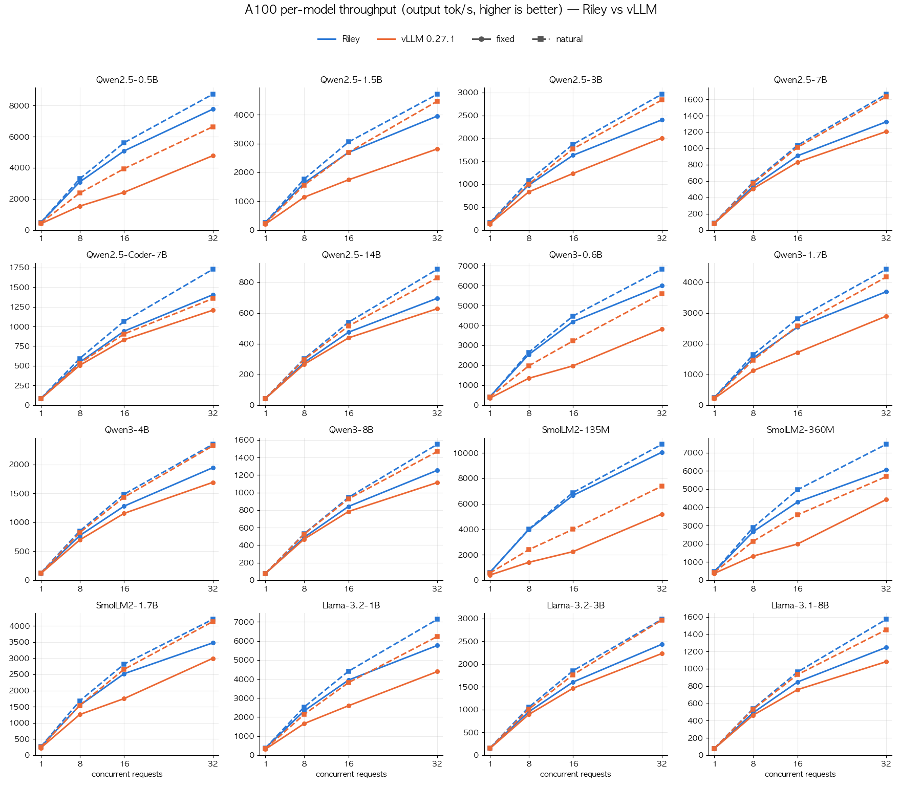

# Riley

**A Rust-native LLM inference server for NVIDIA GPUs.** In the 24-model A100
qualification, Riley served more tokens per second at 8–32 concurrent clients
and reached the first token sooner than vLLM 0.27.1 on the tested workloads.

Riley (Rust Inference LLM Engine) serves Llama- and Qwen-style models over an
OpenAI-compatible completions API. The server, scheduler and KV-cache manager
are Rust; the arithmetic runs in ahead-of-time compiled CUDA kernels and
cuBLASLt. There is no Python in the serving process.

> Status: 0.1.0 (2026-11-12). Results below are BF16,
> greedy decoding, one GPU unless stated; they are model- and
> workload-specific.

The [November distribution qualification](docs/improvement-plan/06-candidate-qualification.md)
records the tested image, A100 coverage, and outstanding release checks.

## Performance

**October 2026 qualification.** Riley and vLLM 0.27.1 ran on the same
A100-SXM4-40GB for each of the 24 models.

| | Riley vs vLLM |
|---|---|
| **Throughput** at 8–32 concurrent clients | **higher in all 144 cells — 1.01× to 2.97×** |
| **Time to first token** (p50) | **lower in all 192 cells — 1.1× to 8.2× faster** |
| **Time per output token** (p50) at 8–32 clients | lower in 142 of 144 cells |
| One client | within ±3 % (tie) to 1.5× faster on throughput |
| **Output** | identical tokens for a request whatever else is in the batch |



Blue is Riley, orange is vLLM; solid lines are fixed-length output, dashed
lines natural-length output. Each panel has its own y-axis scale.

Concurrency 32, fixed-length output (Riley / vLLM):

| Model | Throughput tok/s | Speed-up | TTFT p50 ms | TPOT p50 ms |
|---|---:|---:|---:|---:|
| SmolLM2-135M | **10048** / 5194 | **1.93×** | **8.6** / 57.0 | **2.37** / 3.05 |
| Qwen2.5-0.5B | **7767** / 4780 | **1.62×** | **9.6** / 54.6 | **3.22** / 3.77 |
| Qwen3-0.6B | **5999** / 3821 | **1.57×** | **12.1** / 48.4 | **4.18** / 5.62 |
| Qwen2.5-Coder-1.5B | **4210** / 2824 | **1.49×** | **17.8** / 45.8 | **6.00** / 8.86 |
| DeepSeek-R1-Distill-Qwen-1.5B | **4199** / 2839 | **1.48×** | **17.8** / 48.1 | **6.03** / 8.65 |
| Qwen2.5-1.5B | **3957** / 2816 | **1.41×** | **19.2** / 45.6 | **6.49** / 8.50 |
| SmolLM2-360M | **6058** / 4429 | **1.37×** | **12.9** / 61.3 | 4.08 / 3.94 |
| Llama-3.2-1B | **5767** / 4393 | **1.31×** | **12.8** / 38.2 | **4.41** / 5.10 |
| Qwen3-1.7B | **3693** / 2897 | **1.27×** | **20.2** / 44.2 | **6.87** / 8.33 |
| Qwen2.5-Coder-3B | **2521** / 2019 | **1.25×** | **29.8** / 54.5 | **10.09** / 12.86 |
| Qwen2.5-3B | **2403** / 2006 | **1.20×** | **31.6** / 53.4 | **10.78** / 12.55 |
| DeepSeek-R1-Distill-Llama-8B | **1242** / 1063 | **1.17×** | **61.0** / 91.8 | **20.56** / 24.36 |
| SmolLM2-1.7B | **3475** / 2997 | **1.16×** | **22.2** / 40.2 | **7.37** / 8.39 |
| Qwen2.5-Coder-7B | **1404** / 1207 | **1.16×** | **55.6** / 82.9 | **18.22** / 21.35 |
| Qwen3-4B | **1947** / 1693 | **1.15×** | **39.5** / 59.2 | **13.24** / 15.44 |
| Llama-3.1-8B | **1248** / 1082 | **1.15×** | **61.7** / 93.6 | **20.43** / 23.89 |
| DeepSeek-R1-Distill-Qwen-7B | **1383** / 1212 | **1.14×** | **55.6** / 81.5 | **18.55** / 21.31 |
| Qwen3-8B | **1254** / 1114 | **1.13×** | **60.7** / 88.1 | **20.38** / 23.23 |
| Qwen3-14B | **699** / 623 | **1.12×** | **109.9** / 162.2 | **37.02** / 41.76 |
| Qwen2.5-14B | **696** / 628 | **1.11×** | **112.5** / 158.2 | **36.56** / 41.09 |
| Qwen2.5-Coder-14B | **697** / 626 | **1.11×** | **114.4** / 161.3 | **36.87** / 41.08 |
| Qwen2.5-7B | **1325** / 1206 | **1.10×** | **58.0** / 82.3 | **19.45** / 21.53 |
| DeepSeek-R1-Distill-Qwen-14B | **692** / 628 | **1.10×** | **115.4** / 164.3 | **36.90** / 41.08 |
| Llama-3.2-3B | **2435** / 2232 | **1.09×** | **31.2** / 44.3 | **10.55** / 11.56 |

More charts and every cell:

- [Per-model comparison](docs/model-coverage-a100-perf-by-model.md): throughput,
  TTFT, TPOT and E2E against concurrency for all 24 qualified models, with one
  table of every number.
- [Model coverage](docs/model-coverage-a100.md): pass criteria, flags, accuracy
  checks, 300 s stability runs and evidence names.

How it was measured: 8 cells per model (1/8/16/32 clients × fixed-length or
natural-length output), 32 warm-up + 192 measured requests, Riley and vLLM run
alternately twice in the same session and averaged. Prefix caching is off on
both. vLLM uses its normal compile + CUDA Graph path with
`--gpu-memory-utilization 0.6` (0.9 for the 14B models, which do not load at 0.6).

In the 0.1.0 long-context remeasurement with the opt-in prefill burst, Riley's
first-token latency relative to vLLM was 0.52–1.10× for `rag-c1` and 0.62–1.19×
for `rag6k-c1`. The heaviest `rag-c8` tail reached 1.44× at p95. In the separate
64-token `closed-c1` remeasurement, TPOT across the 24 models was 0.882–1.015×.
These figures refer to their respective workload settings. See the
[current goal measurements](docs/goal.md) and [serving validation](docs/serving-validation.md).
In the original qualification matrix, eighteen models were measured
with the native profile shown under [Usage](#start-the-server); six
Qwen2.5/SmolLM2 models used earlier flag sets, listed in the
[measurement sources](docs/model-coverage-a100-perf-table.md#측정-출처).

### Two GPUs: Qwen2.5-32B with tensor parallelism

Qwen2.5-32B-Instruct does not fit on one 40 GB A100 for either engine. With
`--tensor-parallel-devices 6,7` Riley splits it over two NVLink-connected
A100s (its own deterministic all-reduce, so outputs stay batch-invariant)
against vLLM `--tensor-parallel-size 2`. The original qualification matrix was:

| Clients | Throughput tok/s (fixed / natural) | TTFT p50 ms (fixed) | TPOT p50 ms (fixed) |
|---|---|---:|---:|
| 1 | **35.2** / 35.2 vs 34.7 / 35.3 | **39.5** / 42.3 | **27.77** / 27.99 |
| 8 | **221.9** / **247.3** vs 216.5 / 246.2 | **95.9** / 114.8 | 31.44 / **31.42** |
| 16 | **375.6** / **443.2** vs 352.9 / 429.4 | **107.6** / 144.6 | **36.51** / 37.44 |
| 32 | **557.9** / **724.4** vs 511.5 / 687.1 | **139.6** / 192.6 | **46.42** / 50.26 |

Riley first, vLLM second. The original eight-cell matrix narrowly missed its
TPOT target in both eight-client cells. The later 0.1.0 64-token `closed`
remeasurement had TPOT ratios of 0.981, 1.008, 1.021 and 1.000 at C1/C8/C16/C32.
All four landed within the ±3% tie band, with higher throughput and lower
TTFT. Eight-cell qualification still uses the original fixed/natural matrix.
[Tensor-parallel design](docs/tensor-parallel-design.md#status-2026-11-01) · [Remeasurement](docs/goal.md)

### Shared prompts: the prefix cache

The tables above run with prefix caching off. With `--prefix-cache-blocks N`,
requests that start with the same tokens reuse each other's prompt KV blocks.
It is off by default. On Qwen2.5-7B, with 448 of 477 prompt tokens shared and
both engines' caches on:

| Clients | Throughput tok/s | TTFT p50 ms | TTFT p95 ms | TPOT p50 ms |
|---|---:|---:|---:|---:|
| 1 | **83.6** vs 81.5 | **16.1** / 20.3 | **16.3** / 22.3 | **11.81** / 12.00 |
| 8 | **615** vs 609 | **39.4** / 41.9 | 57.8 / **49.7** | **12.06** / 12.16 |
| 32 | **2156** vs 2026 | **41.7** / 59.5 | 115 / **102** | **13.53** / 13.87 |

Riley first, vLLM second. Compared with its own cache-off run, Riley at 32
clients goes from 765 to 2156 tok/s, and every output stayed identical. Without
a shared prefix it costs nothing measurable. See the
[prefix cache](docs/prefix-cache.md) for sizing, guarantees and limits; clients
can infer each other's recent prefixes, so enable it only among clients that
may share that knowledge.

### Output quality

October 2026 GSM8K qualification (1,319 questions, 4-shot, greedy), Riley / vLLM:
the two engines are within 1.2 points on every model except where vLLM's
tokenizer is broken (DeepSeek-R1-Distill-Llama-8B: Riley 67.2 %, vLLM 42.9 %,
see below). For example Qwen2.5-7B 86.3 / 86.2 %, Qwen3-8B 87.7 / 87.6 %,
Qwen3-14B 91.1 / 91.7 %, Llama-3.1-8B 77.3 / 78.0 %. Every model is listed in
[model coverage, section 6](docs/model-coverage-a100.md#6-품질과-큰-모델-2026-10-31).
Token agreement with Hugging Face BF16 is in the same range as vLLM's on all
20 compared models, after a fix for FlashInfer's finite mask value, which
Qwen2.5-7B's attention logits exceeded
([section 6.6](docs/model-coverage-a100.md#66-qwen25-7b-계열의-낮은-hf-일치-flashinfer-logit-범위-2026-11-01)).

The November 19 candidate recheck used identical prompt token IDs between
Riley and vLLM for all 1,319 questions on each of Qwen2.5-3B, Qwen2.5-7B,
Llama-3.2-3B and Qwen3-4B. All four met the −1.2 percentage-point quality
threshold. The same report records the remaining long-prompt token differences
against Hugging Face BF16 SDPA. [Candidate quality results](docs/improvement-plan/04-long-accuracy-result.md)

Older campaigns (RTX 4090, Qwen3-4B kernel experiments, rejected candidates)
are kept in the [performance experiment log](docs/performance-experiments.md).

## Highlights

- **Continuous batching**: prompt and decode work share each GPU step.
- **Paged KV cache** with device capacity set at start-up. Requests allocate
  blocks within that capacity.
- **Batch-invariant output**: a request produces the same tokens whatever else
  is in the batch.
- **Verified checkpoints**: Hugging Face safetensors are loaded directly, and
  only if every file matches a hashed manifest.
- **Streaming, cancellation and bounded queues** built into the server.
- **Agent API**: a supported subset of JSON Schema constrained by a grammar, OpenAI
  `tools` with forced `tool_choice`, `logprobs`, Bearer API keys, and contexts
  of up to 8,192 tokens. See the [API reference](docs/api.md).
- **LoRA adapters** merged into a checkpoint with
  [`riley-checkpoint merge-lora`](tools/riley-checkpoint/README.md).

## Installation

### Docker

The quickest start is the container image. It needs an NVIDIA driver 550 or
newer and the [NVIDIA Container Toolkit](https://docs.nvidia.com/datacenter/cloud-native/container-toolkit/latest/install-guide.html),
and carries kernels for `sm_80` (A100), `sm_86` (RTX 30xx/A10) and `sm_89`
(RTX 40xx/L4/L40). Pass a Hugging Face model id, as with vLLM:

```bash
docker run --gpus '"device=0"' -p 8080:8080 -v riley-models:/models \
  riley:cu124 serve --model Qwen/Qwen2.5-7B-Instruct
```

```bash
curl -s http://localhost:8080/v1/chat/completions -H 'Content-Type: application/json' \
  -d '{"model": "Qwen/Qwen2.5-7B-Instruct", "messages": [{"role": "user", "content": "What is the capital of France?"}], "max_tokens": 32}'
```

The first start resolves the id (optionally `@branch`, `@tag` or `@commit`) to
a commit, checks that Riley supports the model's `config.json`, and downloads
it into `/models/hub`; every weight file is checked against the Hub's own LFS
SHA-256 and every JSON file against its git blob id. Later starts reuse the
download and, if the Hub is unreachable, fall back to the newest one. Supported
are the dense Llama, Qwen2.5/Qwen3 and SmolLM2 architectures in BF16
safetensors; other models are refused before any weight is downloaded.

`serve --model` adds `--model-id` (the id as given), the native profile shown
under [Usage](#start-the-server), a fitting `--max-weight-bytes` and
`--bind 0.0.0.0:8080`; any `riley serve` option you add is passed through and
wins over these. Other commands:

| Command | What it does |
|---|---|
| `serve --model NAME` | Also takes a bundled preset name, e.g. `qwen3-4b`: 16 of the models in the table above at the measured commits |
| `serve --model /models/DIR ...` | Serve a checkpoint you prepared yourself |
| `presets` | List the bundled presets and their Hub repositories |
| `download MODEL...` | Download and verify Hub ids or presets into `/models` without serving |
| `riley-checkpoint ...` | The checkpoint tool described under [Prepare a model](#prepare-a-model) |

Set `-e HF_TOKEN=...` for gated repositories. The container runs as UID 65532;
a named volume works as is, while a host directory mounted at `/models` must be
writable by that user (or run with `--user "$(id -u):$(id -g)"`).

Build the image yourself from the repository root:

```bash
docker build -f deploy/docker/Dockerfile -t riley:cu124 .
```

Pass `--build-arg RILEY_CUDA_ARCHITECTURES=80` to compile for fewer GPUs and
build faster. Presets live in [`deploy/docker/presets`](deploy/docker/presets);
each is a `riley-checkpoint` manifest cross-checked against the Hub's own
size, LFS SHA-256 and git blob ids at the pinned commit.

### Requirements

| | Needed | Tested with |
|---|---|---|
| OS | Linux x86_64 | Ubuntu 22.04 |
| GPU | One NVIDIA GPU, compute capability 8.0 or newer | A100-SXM4-40GB (`sm_80`), RTX 4090 (`sm_89`) |
| CUDA Toolkit | 12.x with `nvcc`, cuBLAS and cuBLASLt | 12.4 (A100), 12.8.1 (RTX 4090) |
| Rust | 1.85, pinned by `rust-toolchain.toml` | 1.85.0 |
| Build tools | CMake 3.22+ and a C/C++ compiler | |

Python is not needed to build or run the server.

### Build

Kernels are compiled ahead of time for the GPU architectures in
`RILEY_CUDA_ARCHITECTURES` (default `89`). Set it to your GPU: `80` for A100,
`86` for RTX 30xx/A10, `89` for RTX 40xx/L4/L40, or a list such as `80;89`.

```bash
git clone https://github.com/hkjeon13/riley.git
cd riley
export CUDA_HOME=/usr/local/cuda
export RILEY_CUDA_ARCHITECTURES=80
cargo build --locked --release -p riley-server --features server,hf-exact-probe
```

The binary links the CUDA runtime and cuBLASLt dynamically, so put them on the
loader path before running it:

```bash
export LD_LIBRARY_PATH="$CUDA_HOME/lib64:$LD_LIBRARY_PATH"
./target/release/riley --version
```

Without a CUDA toolkit you can still build and test everything that does not
touch the GPU:

```bash
cargo test --locked --workspace --no-default-features
```

### Prepare a model

Riley reads Hugging Face files (`config.json`, `tokenizer.json`, BF16
safetensors) directly, but only from a directory that has a
`riley-checkpoint.json` manifest listing every file with its size and SHA-256
and the exact Hub commit. A server will not start on a checkpoint whose files
do not match.

1. Write a manifest plan for the model (`plan.json`). The checkpoint tool
   (built in step 2) writes it from the Hub's own metadata: weight files are
   pinned by their LFS SHA-256, JSON files by matching their git blob id, at
   the commit the revision resolves to:

   ```bash
   tools/riley-checkpoint/target/release/riley-checkpoint plan \
     --repository Qwen/Qwen3-4B --revision main --output plan.json --allow-network
   ```

   Or write it by hand. It names the Hub repository, the full 40-character
   commit, and each file:

   ```json
   {
     "format": "riley-checkpoint-v1",
     "source_model": "Qwen/Qwen3-4B",
     "source_revision": "<40-character commit>",
     "converter_revision": null,
     "transforms": [],
     "dtype": "bf16",
     "files": [
       { "path": "config.json", "bytes": 726, "sha256": "<64 hex digits>" },
       { "path": "tokenizer.json", "bytes": 11422654, "sha256": "<64 hex digits>" }
     ]
   }
   ```

   List the config, the tokenizer (plus `tokenizer_config.json` for Qwen, and
   for chat on other models), optionally `generation_config.json` and
   `chat_template.jinja`, and one weight layout: `model.safetensors`, or
   `model.safetensors.index.json` with every shard it names. Take sizes and
   SHA-256 values from a source you trust: the Hub file page shows them for
   weight (LFS) files, and `sha256sum` gives them for files you have already
   reviewed.

2. Build the checkpoint tool and let it download, check and load the files:

   ```bash
   cargo build --locked --release --features hub \
     --manifest-path tools/riley-checkpoint/Cargo.toml
   tools/riley-checkpoint/target/release/riley-checkpoint download \
     --manifest plan.json --destination /models/qwen3-4b --allow-network
   ```

   For gated models such as Llama, add `--token-env HF_TOKEN` and export the
   token beforehand. If you already downloaded the files as regular files (not
   Hub cache symlinks), use `prepare --manifest plan.json --source <dir>
   --destination /models/qwen3-4b` instead.

3. Check the result at any time:

   ```bash
   tools/riley-checkpoint/target/release/riley-checkpoint verify \
     --checkpoint /models/qwen3-4b
   ```

The destination directory must not exist yet. Details and guarantees:
[`tools/riley-checkpoint/README.md`](tools/riley-checkpoint/README.md).

## Usage

### Start the server

The example below uses the fixed-tile native profile. The performance tables
link to the settings used for each model and workload.

```bash
./target/release/riley serve \
  --model /models/qwen3-4b --model-id qwen3-4b \
  --inference-profile native-bf16-varlen-v1 \
  --max-active-sequences 32 \
  --max-output-tokens 128 \
  --max-weight-bytes 34359738368
```

| Option | What it sets |
|---|---|
| `--inference-profile native-bf16-varlen-v1` | BF16 kernels, decode-step CUDA capture and fixed-tile attention. The profile supplies 1,024 context tokens, 256 step rows and 256 prefill tokens by default. The fixed-tile route supports up to 8,192 context tokens and 1,024 step rows. Explicit CLI values override the profile |
| `--max-active-sequences 32` | Maximum active requests in this example. The CLI defaults to 8, and the fixed-tile route accepts up to 32 |
| `--max-output-tokens 128` | Upper bound for a request's `max_tokens` |
| `--max-weight-bytes` | Largest checkpoint the server accepts. Defaults to 2 GiB or 8 GiB with the D128 native backend. This example allows 32 GiB |
| `--bind`, `--device` | Listener address (default `127.0.0.1:8080`) and CUDA device |

The native profile needs a head dimension of 64 or 128, which every listed
model has. Without `--inference-profile` the server uses its most conservative
numerical path, which is much slower. These limits size the fixed device KV
pool. Host RSS under load is measured separately in the
[mixed-load results](docs/improvement-plan/05-mixed-soak-result.md#배포-이미지의-혼합-부하).
See `riley serve --help` and [Configuration](docs/configuration.md) for all options.

Wait until the model is loaded:

```bash
curl -s http://127.0.0.1:8080/readyz
```

### Send requests

```bash
curl -s http://127.0.0.1:8080/v1/completions \
  -H 'Content-Type: application/json' \
  -d '{"model": "qwen3-4b", "prompt": "The capital of France is", "max_tokens": 16, "temperature": 0}'
```

Stream tokens as server-sent events with `"stream": true`:

```bash
curl -sN http://127.0.0.1:8080/v1/completions \
  -H 'Content-Type: application/json' \
  -d '{"model": "qwen3-4b", "prompt": "Write a haiku about GPUs.", "max_tokens": 64, "temperature": 0, "stream": true}'
```

The endpoint follows the OpenAI completions shape, so the OpenAI Python client
works unchanged:

```python
from openai import OpenAI

client = OpenAI(base_url="http://127.0.0.1:8080/v1", api_key="unused")
reply = client.completions.create(
    model="qwen3-4b", prompt="The capital of France is", max_tokens=16, temperature=0
)
print(reply.choices[0].text)
```

The prompt is raw text. Supported fields are `max_tokens`, `temperature`,
`top_p`, `seed`, `stop`, `stream`, `stream_options.include_usage` and
`return_token_ids`. Closing the connection cancels the request. Full
reference: [HTTP API](docs/api.md).

### Chat

`POST /v1/chat/completions` renders `messages` with the checkpoint's own chat
template (`chat_template.jinja` or the `chat_template` of
`tokenizer_config.json`), the same way Transformers' `apply_chat_template`
does, and answers in the OpenAI chat shape, streaming included:

```python
reply = client.chat.completions.create(
    model="qwen3-4b",
    messages=[{"role": "user", "content": "What is the capital of France?"}],
    max_tokens=64,
)
print(reply.choices[0].message.content)
```

Besides the completion fields it takes `max_completion_tokens`,
`add_generation_prompt` and `chat_template_kwargs` (for example
`{"enable_thinking": false}` for Qwen3). `max_tokens` defaults to the server's
`--max-output-tokens`. `response_format`, `tools`, `tool_choice` and `logprobs`
are described in the [API reference](docs/api.md). Images and `n > 1` are not
supported. A checkpoint without a chat template serves `/v1/completions` only.

Other endpoints: `GET /v1/models`, `/healthz`, `/readyz`, `/metrics` (JSON
counters) and `/v1/config` (effective configuration).

### Stop the server

Send `SIGINT` (Ctrl-C) or `SIGTERM`. The server stops accepting requests,
finishes or cancels the active ones, frees its GPU memory and exits with
status 0.

## Supported

| | |
|---|---|
| Architectures | `LlamaForCausalLM` (Llama 3.x, SmolLM2), `Qwen2ForCausalLM` (Qwen2.5), dense `Qwen3ForCausalLM` (Qwen3) |
| A100-qualified models | Qwen2.5 0.5B / 1.5B / 3B / 7B / 14B Instruct, Qwen2.5-Coder 1.5B / 3B / 7B / 14B Instruct, DeepSeek-R1-Distill-Qwen 1.5B / 7B / 14B, DeepSeek-R1-Distill-Llama-8B, Qwen3 0.6B / 1.7B / 4B / 8B / 14B, SmolLM2 135M / 360M / 1.7B, Llama-3.2 1B / 3B Instruct, Llama-3.1-8B Instruct |
| Precision | BF16 |
| Hardware | One NVIDIA GPU (A100 and RTX 4090 measured); tensor parallelism over 2–8 peer-connected GPUs (2 × A100 measured) |
| API | `POST /v1/chat/completions` and `POST /v1/completions` with streaming; models, health and metrics endpoints |

Not supported yet: quantised weights, pipeline parallelism, multiple nodes.

## Documentation

| | |
|---|---|
| [Getting started](docs/getting-started.md) | Build, prepare a checkpoint, run, send a request |
| [Configuration](docs/configuration.md) | Every server option and what it changes |
| [HTTP API](docs/api.md) | Endpoints, request fields, streaming, errors |
| [Architecture](docs/architecture.md) | Crates, request flow, KV cache, numerical guarantees |
| [Per-model comparison](docs/model-coverage-a100-perf-by-model.md) | A100 charts and tables, Riley vs vLLM |
| [Model coverage](docs/model-coverage-a100.md) | A100 qualification criteria, flags and evidence |
| [Performance experiment log](docs/performance-experiments.md) | Dated campaigns and rejected candidates |
| [History](docs/HISTORY.md) | How Riley was developed and what improved along the way |

## License

[MIT](LICENSE)
