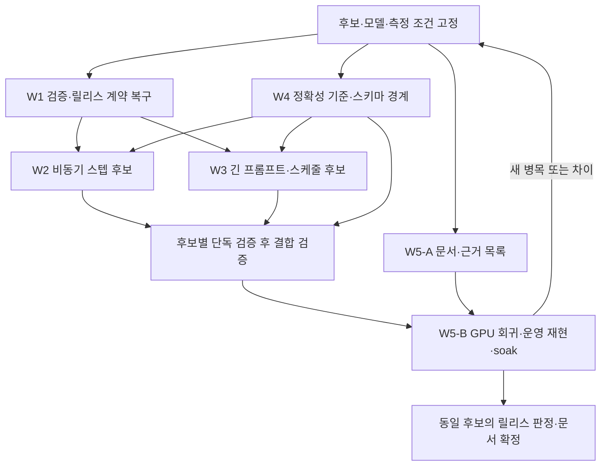

# Riley 개선 종합 계획

작성일 2026-11-13 KST. 초기 기준은 로컬 `main` `37ede4445`와 원격 `origin/main` `9f039de78`이다.

`2b58655f3`의 GitHub·A100 CUDA 이미지에서 런타임 파일 21개가 일치했다. 정규식 분기의 HTTP 검사 10건, 두 GPU의 API 40건씩, 장문 스키마·도구 64건과 45초 혼합 부하를 검증했다. [현재 패키지](04-structured-output-result.md#pattern-선택-분기의-시작과-끝-조건) · [릴리스 판정](06-candidate-qualification.md)

`8a7c618c1` 이미지의 A100 교차 비교에서 30분 합성 부하 4회 동안 54,996건을 정상 완료했고 예상 외 오류는 0건이었다. 후반 RSS는 기준 이미지에서 캐시 끔 +648KiB, 켬 +452KiB였고 jemalloc 시험 이미지에서는 각각 −1,016KiB, −312KiB였다. 격리 복구는 110.26초에 완료됐다. 실제 운영 트래픽·승인 SLO·서비스 복구 확인이 남아 있다. [30분 교차 대조](05-mixed-soak-result.md#로컬-참조-수정-이미지의-30분-교차-대조) · [격리 복구](05-mixed-soak-result.md#로컬-참조-수정-이미지의-격리-복구)

샤드 체크포인트의 SHA-256을 최대 두 개씩 겹쳐 계산하도록 수정했다. Coder-14B 검증 시간은 158.82초에서 92.27초로 41.90% 줄었고, 네이티브 A100 서버의 준비 시간은 27.34–28.48% 줄었다. 동일한 API와 생성 토큰 ID를 확인했다. 새 배포 이미지 `0511b9280`도 A100 API와 45초 혼합 부하 검사를 통과했다. [W5 기동 시간 검증](05-documentation-and-operations.md#샤드-체크포인트-검증-병렬화)

`c5ec7b391` 패키지에서 1,024행 옵션으로 Coder-14B를 실행해 vLLM과 비교했다. 짧은 C32 TPOT p50은 vLLM의 1.043–1.047배, 두 RAG C8 seed의 첫 토큰 p95는 1.434–1.672배로 두 GPU에서 각각 목표를 넘었다. [W3 패키지 교차 비교](03-long-context-result.md#배포-이미지의-coder-14b-교차-비교)

`0511b9280`의 RAG 고정 도착 재생에서 전송 오차 기준을 통과한 두 비교는 첫 토큰 p95가 vLLM의 1.441–1.450배였다. 두 비교 모두 목표를 미달했고, 여섯 비교는 클라이언트 전송 오차가 커 판정에서 제외했다. [고정 도착 결과](03-long-context-result.md#coder-14b-rag-고정-도착-재생-결과)

같은 이미지의 짧은 C32는 vLLM 시각표의 유효한 두 비교에서 TPOT p50이 0.992–1.000배로 목표를 충족했다. 콘텐츠 간격 p99는 Riley 119–125ms, vLLM 34–41ms였다. Riley 시각표의 두 비교는 전송 오차 초과로 보류했다. [C32 고정 도착 결과](03-long-context-result.md#짧은-c32의-고정-도착-재생-결과)

후속 재생에서 GPU 상태 확인을 부하 생성기와 분리하고 서버와 클라이언트를 서로 다른 코어에 배치했다. GPU 7번에서 RAG와 짧은 C32 6개 비교가 모두 전송 오차 기준을 충족했다. RAG 첫 토큰 p95는 vLLM의 0.991–1.529배였고 C32 TPOT p50은 두 시각표에서 0.970–0.996배였다. 같은 vLLM 시각표에서 Riley의 콘텐츠 간격 p99는 125.45ms에서 37.92ms로 줄었다. [CPU 분리 재생 결과](03-long-context-result.md#gpu-상태-확인을-분리한-재생)

같은 RAG 시각표의 측정 128건을 서버 기록과 연결했다. 추적한 약 3,500토큰 두 요청은 TTFT의 약 94%가 입장 이후였다. 두 요청의 입장 이후 구간이 이전 vLLM 전체 TTFT보다 각각 351ms·561ms 길었다. [요청별 서버 시간](03-long-context-result.md#같은-rag-요청의-입장과-첫-콘텐츠)

스텝 계측에서 같은 두 요청은 자신의 prefill을 포함한 스텝에 각각 546ms·545ms를 썼고 다른 prefill을 포함한 스텝이 진행되는 동안 1,215ms·780ms를 기다렸다. 두 실행의 출력 해시는 기존 Riley와 일치했다. [prefill 스텝 분석](03-long-context-result.md#rag-prefill-스텝과-요청별-대기)

혼합 스텝의 prefill을 접수 순서로 배정한 후보는 RAG seed 1의 첫 토큰 p95를 11.84–15.31% 줄였다. 두 GPU에서 출력 1,184쌍이 일치했고 12개 중 7개 비교에서 decode 지연 한도를 넘어 미채택했다. [prefill 순서 후보 결과](03-long-context-result.md#혼합-스텝의-prefill-접수-순서-후보)

행 수를 유지하면서 장문 prefill 순서만 좁혀 바꾼 후속 후보는 RAG의 첫 토큰 p95를 1.93–4.07% 줄였다. GPU 7번의 두 seed는 1단계 목표를 충족했다. GPU 6번에서 decode와 짧은 C32 지연 한도를 넘어 미채택했다. 기존 스텝의 교체 가능 37개 중 33개에서 causal attention 쌍이 증가했고 순서 변경을 끈 두 기준 실행 사이에도 지연 편차가 있었다. [행 수를 유지한 순서 비교](03-long-context-result.md#같은-행-수를-유지하는-장문-prefill-순서-후보) · [계산량과 기준 실행 검산](03-long-context-result.md#같은-행-수에서의-attention-계산량과-기준-실행-차이)

같은 바이너리의 기준 반복에서 C32 첫 토큰 중앙값은 11–12% 달랐다. GPU 7번의 RAG seed 1과 동시 유입에서 기준끼리의 decode 차이는 0.16% 이내였고, 후보는 두 기준 대비 2.38–3.08% 느려 미채택했다. 여섯 실행의 측정 응답 3,552건은 대응 출력이 모두 일치했다. [동일 바이너리 반복 결과](03-long-context-result.md#동일-바이너리의-기준-반복과-prefill-후보)

후속 계측에서 출력 1,184쌍과 스텝 23,524개를 대조했다. 순서 변경으로 두 GPU의 RAG seed 1 첫 토큰 p95가 약 10% 줄었으나 일부 부하에서 decode 회귀 한도를 넘어 미채택했다. GPU 7번 기준의 seed 1에서 120ms 이상 decode 간격 94개 중 25개에는 prefill 1,023행과 decode 1행을 실행하는 별도 스텝이 있었다. CPU에서는 그 모양을 만드는 aging 경로에서 대기 중인 decode를 모두 예약하는 후보를 시험했다. [스텝별 결과](03-long-context-result.md#prefill-순서-변경에-따른-gpu-스텝과-decode-대기) · [행 예약 CPU 검증](03-long-context-result.md#오래-기다린-prefill의-decode-행-예약)

같은 Coder-14B의 후속 교차 실험에서 decode 행 예약은 두 GPU의 RAG 토큰 간격 p99를 45.67–47.55%, TPOT p50을 3.46–13.54% 줄였다. 대응 출력 1,184쌍이 일치했고 12개 비교가 모두 송신 오차·decode 회귀 기준을 충족했다. GPU 7번에서 vLLM 대비 RAG 첫 토큰 p95는 1.437–1.527배여서 최종 목표가 남아 있다. [행 예약 교차 결과](03-long-context-result.md#오래-기다린-prefill의-decode-행-예약)

행 예약과 prefill 순서 변경의 결합은 예약 단독 대비 RAG 첫 토큰 p95를 2.14–11.79% 줄였고 토큰 간격 p99 변화는 −0.79%에서 +0.32%였다. GPU 6번의 RAG decode와 GPU 7번의 짧은 C32 첫 토큰 지연은 회귀 한도를 넘었다. 결합 설정의 채택을 보류하고 행 예약 단독을 일반 CUDA 서빙에서 검증한다. [결합 교차 결과](03-long-context-result.md#행-예약과-prefill-순서-변경의-결합-대조)

일반 CUDA 서빙에서 행 예약 옵션을 켜면 Coder-14B의 RAG 토큰 간격 p99가 46.08–46.51%, TPOT p50이 4.27–8.85% 줄었고 대응 출력 1,184쌍이 일치했다. 송신 기준을 충족한 재시험에서도 RAG 개선은 재현됐고 짧은 C32의 첫 토큰 p50은 GPU 6·7에서 2.92%·7.81% 늘었다. 옵션의 코드 반영을 보류하고 송신 뒤 구간을 대조한다. [일반 CUDA 서빙 결과](03-long-context-result.md#일반-cuda-서빙의-decode-행-예약-옵션) · [C32 재시험](03-long-context-result.md#짧은-c32의-전송-기준-재시험)

서버 관측값을 연결한 후속 실행에서 짧은 C32의 첫 토큰 p50은 GPU 6번에서 3.21% 줄고 7번에서 21.21% 늘었다. 같은 요청끼리 비교한 입장 대기의 변화 중앙값은 각각 −2.05ms와 +10.22ms였고, 입장 후 구간은 두 GPU에서 0.06ms 미만으로 변했다. 행 예약의 코드 반영은 보류한다. [C32 입장 대기 결과](03-long-context-result.md#행-예약-후-짧은-c32의-입장-대기)

RAG 선행 유무의 네 조합을 두 GPU에서 대조했다. RAG 없이 진행한 C32는 두 GPU 모두 회귀 한도를 통과했고, RAG 선행 조건에서는 GPU 6번의 첫 토큰 p50이 14.36% 늘고 GPU 7번에서 3.01% 줄었다. 무부하 실행의 워밍업 시작 오차가 사전 허용치를 넘어 조건 간 인과 판정을 보류한다. 대응 출력 1,024쌍은 일치했다. [RAG 이력 교차 결과](03-long-context-result.md#c32-실행-전-rag-부하의-유무)

같은 RAG 선행 재생에서 C32의 명령 큐 대기 p50은 21.57–27.50ms였고, CUDA 실행 구간과 겹친 시간의 p50은 21.51–27.45ms였다. 이 계측의 C32 첫 토큰 p50은 두 GPU에서 2.01–2.34% 줄었다. 일반 바이너리에서 관측된 회귀의 원인은 미확정이다. [진행 중인 스텝과 입장 대기](03-long-context-result.md#c32-명령-대기와-진행-중인-스텝)

요청별 prefill 조각을 512행으로 낮춘 후보는 832쌍의 출력을 보존했으나 네 RAG C8 비교에서 첫 토큰 p95가 2.74–14.39% 늘어 미채택했다. [W3 조각 크기 대조](03-long-context-result.md#coder-14b-요청별-prefill-조각-크기)

W4 장문 답변의 같은 33개 문제를 채팅으로 보내자 Riley·vLLM 모두 정답만 출력하고 정상 종료한 경우가 0/33에서 22/33으로 늘었다. 두 채팅 형식에서 Riley의 동시성 1·8 결과는 각각 33/33 일치했고, 두 엔진 모두 한국어 산술은 0/11이었다. [장문 채팅 비교](04-long-accuracy-result.md#같은-장문-문제를-채팅-형식으로-재생)

한국어 산술 대조에서 Riley와 vLLM은 필요한 수량을 11/11건 찾아냈다. 새 수량의 산술 8개에서는 Riley의 직접 계산이 0/8건, JSON 추출 후 호출자가 한 정수 연산이 8/8건이었다. 두 경로의 동시성 1·8 응답은 각각 8/8건에서 일치했다. 응답 스키마와 지정 도구에서 URI 인코딩된 로컬 `$ref`도 수정해 CPU 회귀 검사를 통과했다. [산술 대조 결과](04-long-accuracy-result.md#한국어-산술의-피연산자-추출과-계산-대조) · [새 수량의 구조화 추출](04-long-accuracy-result.md#다른-수량의-장문-산술에서-구조화-추출-검증) · [URI 참조 검증](04-structured-output-result.md#로컬-참조의-uri-인코딩)

| 작업 | 현재 근거와 다음 검증 |
|---|---|
| W1 검증·릴리스 | Linux Production CPU, 고정 RC3 테스트 34건, CUDA 12.8 네이티브 빌드·Clippy와 CUDA 12.4 이미지 CPU 검증을 통과했다. `0511b9280`의 배포 입력과 GitHub·A100 패키지의 런타임 해시를 대조했다. [W1 결과](01-validation-result.md) |
| W2 실행 중첩 | `after-submit-v1`은 A100 32행 decode의 커널 공백 중앙값을 51–72µs 줄였고 네 일반 서빙 비교에서 처리량을 0.38–0.89% 높였다. `native-bf16-varlen-v1`의 기존 발행 정책을 유지한다. 정렬된 KV 테이블과 이벤트 복사 제거는 SmolLM2의 단일 iteration에서 채택 이득을 충족하지 못했다. [발행 정책 계측](02-async-step-result.md#발행-정책과-32행-decode-커널-간격) · [두 번째 후보 결과](02-async-step-result.md#커밋된-이벤트-데이터의-복사-제거) |
| W3 장문·스케줄 | Qwen2.5-14B에서 1,024행 QKV 후보는 고정 도착 대조의 첫 토큰 p95를 3.54–12.88% 줄였으나, 같은 형상의 Coder-14B에서는 역순 동시 유입의 decode TPOT이 1.99% 늘어 공통 적용을 기각했다. Qwen2.5-14B의 50ms 유입에서 41번 요청의 prefill 조각 사이 대기는 399ms 늘었고 KV 예약은 한도보다 744블록 여유가 있었다. 장문 경계 11개는 네 chunk·KV 조합의 진단에서 308건의 응답이 토큰 ID까지 일치했다. KV 768블록의 기본 30초 실행은 C32에서 408이 발생했다. [고정 도착 결과](03-long-context-result.md#두-rag-seed의-고정-도착-재생) · [Coder-14B 결과](03-long-context-result.md#coder-14b의-1024행-후보-검증) · [같은 실행의 동시 계측](03-long-context-result.md#같은-실행의-요청-대기와-cuda-커널-대조) · [경계·KV 검증](03-long-context-result.md#장문-chunk와-kv-한도의-교차-대조) |
| W4 정확성·스키마 | 장문 29건의 Riley·HF 첫 분기 7건 중 6건은 decode였다. Riley ID가 단독 최대인 두 사례에서 첫 레이어 QKV를 정확한 HF 행으로 교체해도 선택 토큰과 전체 생성 결과가 같았다. 같은 두 사례의 residual 교체에서 토큰 선택에 영향을 준 첫 경계를 레이어 0의 MLP 이후와 attention 직후로 각각 좁혔다. 첫 prefill 분기의 레이어와 네 모델의 GSM8K를 검증했다. 현행 이미지 두 개에서 장문 스키마·도구 호출 128건을 확인했다. [장문·품질 결과](04-long-accuracy-result.md#실제-bf16-점수-행의-분기-검산) · [순전파 대조](04-long-accuracy-result.md#대체-qkv-행이-최종-decode에-미친-영향) · [스키마 결과](04-structured-output-result.md) · [residual 경계 검증](04-long-accuracy-result.md#residual-경계-교체로-decode-토큰-선택을-재현) · [동일 입력 투영 대조](04-long-accuracy-result.md#같은-입력으로-레이어-0의-mlp와-attention-출력-투영-대조) · [투영 정밀도 검산](04-long-accuracy-result.md#투영의-bf16-반올림과-축소-정밀도-대조) · [실제 GEMM 계획](04-long-accuracy-result.md#실제-riley-계획과-split-k-부분합-정밀도) · [대안의 서빙 재생](04-long-accuracy-result.md#투영-대안을-실제-decode-응답에서-재생) · [행 수 검증](04-long-accuracy-result.md#후보별-21개-배치-행-수-대조) · [계획 31 전체 적용 기각](04-long-accuracy-result.md#계획-31-전체-서빙-대조와-판정) |
| W5 문서·운영 | 최신 이미지 두 개의 닫힌 RAG 3,072건과 고정 도착 재생 2,048건에서 출력이 일치했다. 닫힌 부하에서는 seed 2의 TTFT p95가 실행 순서에 따라 +21.14%, −6.87%였고, 같은 시각표를 사용한 네 비교의 변화는 −0.87%~+0.25%였다. [닫힌 RAG 교차 측정](05-mixed-soak-result.md#최신-파생-이미지의-rag-교차-측정) · [고정 도착 결과](05-mixed-soak-result.md#최신-rag-seed-2의-고정-도착-재생) · [운영 부하와 회수 절차](05-documentation-and-operations.md#합성-부하의-확인-기준) |

## 1. 목표와 현재 위치

Riley 0.1.0의 기본 서빙 기능을 유지하면서, 변경을 신뢰할 수 있는 검증 체계를 먼저 복구하고 남은 성능·정확성 한계를 단계적으로 줄인다. 범위는 앞서 확인한 다섯 개선 항목이다.

초기 조사 당시 로컬 main은 원격보다 9커밋 앞섰고 차이는 재측정 근거와 `docs/goal.md`였다. 새 측정은 실제 기준 커밋과 바이너리에 각각 결속한다.

`main`에 반영한 변경은 W1의 CPU·CUDA·배포 이미지 검증 복구, W2의 스트리밍 취소와 정상 완료 처리 수정, W4의 JSON 스키마 오류·종료 처리 수정, W5의 prefix cache 메트릭이다. [W1 검증](01-validation-result.md) · [취소 순서 검증](02-async-step-result.md#마지막-토큰-전달과-취소의-순서) · [스키마 검증](04-structured-output-result.md) · [메트릭을 포함한 패키지](05-mixed-soak-result.md#prefix-cache-메트릭을-포함한-배포-패키지)

### 현재 기본값과 지원 범위

| 구분 | 현행 `main`의 적용 범위 |
|---|---|
| 배포 이미지 기본값 | `native-bf16-varlen-v1` 프로파일은 `after-submit-v1`, 배치·prefill 256행을 사용한다. 직접 CLI에서 프로파일을 지정하지 않으면 이벤트 발행 기본값은 `immediate-v1`이다. [프로파일 설정](../configuration.md#execution-options) |
| 명시적 설정 | `--prefix-cache-blocks`와 `--prefill-burst-steady-budget`으로 기존 캐시·버스트 정책을 사용한다. 모델별 예산과 비용은 설정 문서에 따른다. [캐시 설정](../configuration.md#prefix-cache) · [스텝 예산](../configuration.md#step-size) |
| 시험 후보와 미달 지표 | 일부 RAG의 TTFT와 Coder-14B의 C32 목표는 미달이다. 512행 후보는 C32 p95를 줄였지만 p50 회귀 한도를 넘었다. jemalloc은 30분 합성 부하와 격리 복구를 통과했고 운영 릴리스는 보류한다. [성능 판정](03-long-context-and-scheduling.md#현재-적용-판정) · [512행 전송 대조](03-long-context-result.md#c32의-httpsse-전송-시각-대조) · [릴리스 판정](06-candidate-qualification.md#현재-판정) |
| 미지원 범위 | 지원 모델은 모델 표에 따른다. 구조화 출력은 문서에 명시한 스키마 부분집합을 적용하며 `oneOf` 등 강제할 수 없는 제약에는 `400 invalid_schema`를 반환한다. [모델 지원 표](../model-support.md) · [스키마 계약](../api.md#structured-output) |

현재 구현은 연속 배칭, Paged KV, CUDA Graph, 스트리밍·취소, structured output·tools·logprobs, 8K 문맥, prefix cache, 정적 LoRA 병합, 32B TP=2를 포함한다. 단일 GPU 24개 모델의 qualification과 광범위한 측정 기록이 있다. 이것이 모든 워크로드·모델·장비의 목표 충족을 뜻하지는 않는다.

## 2. 문서별 책임과 연결

| ID | 상세 문서 | 해결할 문제 | 다른 작업에 넘기는 결과 |
|---|---|---|---|
| W1 | [검증·CI·릴리스 계약 복구](01-validation-and-release.md) | 포맷·Clippy 실패, 릴리스 계약과 소스 불일치, 측정 실패 누락 | 재현 가능한 기준 빌드와 신뢰 가능한 판정 도구 |
| W2 | [비동기 스텝과 CPU/GPU 중첩](02-async-step.md) | 스텝 사이 호스트 작업으로 생기는 GPU 유휴 | GPU 기준선, 기존 옵션 비교 및 채택 판단 |
| W3 | [긴 프롬프트와 혼합 부하](03-long-context-and-scheduling.md) | RAG 첫 토큰 지연, p95, prefill과 decode의 상충 | 워크로드별 정책과 성능·지연 비용표 |
| W4 | [장문 정확성과 스키마 계약](04-correctness-and-schema.md) | HF 장문 차이, 스키마 의미의 불완전한 보장 | 수치 변경·스케줄 변경을 판정할 정확성 검사 |
| W5 | [문서·관측·운영 검증](05-documentation-and-operations.md) | 문서 드리프트, 수동 GPU 검증, 실제 트래픽 근거 부족 | 동일 후보에 묶인 문서·운영 근거·릴리스 체크리스트 |

W4는 장문 수치 정확성(W4-A)과 스키마 계약(W4-B)으로 나누어 수행한다. W5도 문서 정리(W5-A), GPU 자동화·운영 검증(W5-B)으로 나누면 장기 작업 때문에 즉시 가능한 정리가 밀리지 않는다.

병렬 조사는 가능하지만 W2와 W3를 동시에 기본값에 반영하지 않는다. 각 후보의 인과관계를 먼저 확인한 뒤 조합한다.

## 3. 초기 기준 조사에서 확인한 항목

| 구분 | 근거와 해석 |
|---|---|
| 로컬 CPU 라이브러리 검사 | Rust 1.85.0, `--workspace --lib --no-default-features --features riley-server/server`: 621건 통과, 1건 ignored. GPU 검증을 포함하지 않는다. |
| 샌드박스 영향 | 최초 실행의 HTTP 테스트 26건은 로컬 포트 바인딩 거부로 실패했다. 해당 제한을 해제한 라이브러리 재실행에서 서버 97건 전부 통과했다. 코드 결함으로 집계하지 않는다. |
| 포맷·린트 | `cargo fmt --check`에서 57개 파일 차이. CI 설정의 Clippy 명령도 실패. 오류 수는 첫 실패 크레이트에 한정되므로 전체 결함 수로 보지 않는다. |
| Python 검증 | Python 3.12 벤치마크 스크립트 테스트 182건: 실패 2, 오류 23. 주요 오류는 서버 기본값 소스 해시 불일치. 성능 파생 계약 드리프트도 확인했다. Python 3.10 실행 결과는 환경이 다르므로 별도 기록한다. |
| 운영 기록 | 0.1.0 후보는 API 40/40, 30분 혼합 soak 14,378건·연결 종료 758건에서 오류·KV 잔류가 없었다. 이번 작업에서 GPU로 다시 실행한 결과는 아니다. |
| 남은 성능 | Coder-14B closed-c32 TPOT, SmolLM2-1.7B reason-c32 처리량, 일부 RAG 최종 목표는 미달하며 기존 운영 규칙에 따라 구조 한계로 닫혔다. |
| 아직 모르는 것 | 비동기 구조의 실제 이득, 장문 HF 차이의 최초 원인, 실제 서비스 트래픽의 지연·취소 분포. 조사 가설과 측정 사실을 분리한다. |

당시 로컬 진단 로그는 `/private/tmp/riley-status-*-20261113.log`에 있다. 임시 로그에만 의존하지 말고 W1에서 필요한 재현 로그·요약을 저장소의 새 근거 디렉터리로 옮긴다. 새 후보 결과로 과거 기록을 덮어쓰지 않는다.

## 4. 진행 순서와 단계별 종료 조건

| 단계 | 수행 내용 | 다음 단계로 넘길 조건 |
|---|---|---|
| M0 기준 고정 | HEAD·바이너리·모델·라이브러리·GPU·실행 옵션·워크로드를 식별 | 동일 입력으로 다시 실행할 수 있는 manifest와 알려진 미달 목록 |
| M1 검증 복구 | W1, W4의 최소 재현·독립 판정기, W5-A | 필수 CPU 검사 통과, 해시 드리프트 정상·오류 경로 검증, 실패한 측정을 성공으로 처리하지 않음 |
| M2 원인 확인 | W2·W3 프로파일, W4-A 첫 분기 토큰·층 추적 | 원인별 근거와 한 번에 하나씩 바꿀 후보 목록. 추정 이득만으로 채택하지 않음 |
| M3 후보 구현 | W2·W3를 각각 opt-in으로 구현, W4-B 계약 수정 | 단독 성능·정확성·수명·오류 처리 검사 통과 |
| M4 결합 검증 | 기준/W2/W3/W2+W3 비교, affected 모델 전부 재검증 | 상호작용·회귀·지원 범위가 명시된 최종 후보 |
| M5 운영·릴리스 | W5-B, 동일 바이너리 API·soak·패키징·문서 확정 | 실패·보류·한계 항목까지 포함한 릴리스 판정서 |

하드웨어가 없어 M2 이후를 실행하지 못하면 M1까지 완료 상태와 필요한 장비·실험을 남긴다. CPU 통과를 GPU 기능 통과로 대체하지 않는다.

## 5. 공통 측정·판정 규칙

기존 [목표와 운영 규칙](../goal.md)을 유지한다. 아래 표의 기존 기준과 신규 제안을 구분한다.

| 항목 | 판정 규칙 |
|---|---|
| 출력·배치 불변성 | 성능 변경은 이전 승인 빌드와 토큰·출력 바이트 동일. 배치 구성·취소 순서를 바꿔도 요청별 출력이 같아야 한다. |
| 수치 변경 | KV 분할·GEMM 기준·reduction 변경은 별도 변경으로 식별한다. 기존 문서의 사전 승인·모델 재검증 절차를 적용한다. 이 계획 작성은 수치 변경 실행 승인이 아니다. |
| 회귀 | 기존 규칙: 짧은 프롬프트 지표 2% 이상, decode TPOT 1% 이상 악화 금지. 개선 목표의 ±3% 동률 규칙과 혼동하지 않는다. |
| 상대 성능 | 처리량은 Riley/vLLM이 높을수록, TTFT·TPOT은 낮을수록 좋다. 분모를 셀에 명시한다. |
| 실행 순서 | Riley/vLLM 교대 `rvvr`를 기본으로 하되 셀별 실제 warm-up·표본 수를 기록한다. `compare.py`의 closed-c1·RAG는 192건 공통 설정이 아니다. |
| 비교 환경 | 모델 revision, 토큰화·BOS/EOS, 정밀도, KV 용량, prefix cache, 문맥·출력 제한, CUDA·cuBLAS, GPU 공유 상태를 맞춘다. 수정된 vLLM 기준선은 기본 기준선과 분리한다. |
| 꼬리 지연 | 작은 RAG 표본은 탐색용이다. 최종 p95 판정은 서로 다른 seed·반복과 충분한 완료 요청 수를 사전 지정해 재측정한다. 평균 p95 하나로 변동을 숨기지 않는다. |
| 종료 | 기존 규칙: 출력 바이트를 지키는 레버 두 개가 각각 2% 미만이면 근거와 함께 현재 구조 한계로 닫는다. 새 구조 가설에 근거가 있을 때만 재개한다. |
| 신규 제안 | 장기 soak·운영 SLO·프로파일 오버헤드·GPU CI 모델 축소 전략은 각 문서의 제안이다. 측정 전에 기준을 확정하고 결과를 보고 낮추지 않는다. |

## 6. 증거를 공유하는 방법

새 작업은 `benchmarks/evidence/<날짜>-improvement/<work-id>/<candidate-id>/` 아래에 둔다. 아래 파일명은 제안하는 산출물이며 현재 구현된 도구·스키마가 아니다.

- `manifest.json`: Git SHA·dirty 여부·source archive SHA·바이너리 SHA·모델 파일 해시·도구 버전·장비·라이브러리·실행 옵션·시간.
- `workload.json`: 입력 ID·seed·입출력 길이·요청 간격·취소·기능 조합·표본 수. 문장 수 대신 실제 토큰 수도 기록.
- `raw/`: 요청별 결과·오류·서버 종료 상태·메트릭·원본 프로파일. 성공한 셀만 추리지 않는다.
- `comparison.json`: 기준/후보 지표·분산·출력 차이·탈락 사유. 현재 판정 도구를 변경할 때는 W1의 계약을 함께 갱신.
- `decision.md`: 채택/opt-in 유지/기각/구조 한계/미검증, 근거 링크와 다음 작업.

W1은 manifest와 실패 판정을 제공한다. W4는 같은 입력 ID의 정확성 판정을 제공한다. W2·W3는 같은 후보 ID로 성능·실행 경로를 붙인다. W5는 이 결과를 사용자 문서와 운영 검증에 연결한다. 서로 다른 빌드의 좋은 결과만 조합해 하나의 릴리스 근거로 쓰지 않는다.

[후보 검증 근거와 릴리스 판정](06-candidate-qualification.md)에서 실제로 확인한 바이너리·이미지와 남은 출시 조건을 확인할 수 있다.

## 7. 변경 묶음과 회수 방법

1. W1의 린트·계약 복구와 W5-A의 문서 정리는 실행 동작 변경과 분리한다. 포맷이 해시 결속 소스를 바꾼다는 점도 검토 기록에 남긴다.
2. W4-B의 스키마 계약 수정은 API 동작 변경으로 별도 검토한다. 지원 범위를 줄이는 경우 오류 코드와 이전 요청의 영향을 문서화한다.
3. W2·W3는 각각 기존 경로로 돌아갈 수 있는 opt-in 후보로 시작한다. 토글 이름·기본값은 구현 전 설계에서 확정한다.
4. 수치 변경이 필요하면 성능 구조 변경과 분리해 품질·모델 재검증 범위를 명시한다.
5. 최종 소스·계약을 고정하고 그 후보로 패키지·정확성·성능·soak를 수행한다. 이후 소스가 바뀌면 영향 범위에 따라 필요한 검사를 다시 실행한다.

## 8. 종합 완료 체크리스트

- [x] W1 로컬: CPU 검사와 릴리스·성능 계약의 정상/드리프트 경로가 통과한다([결과](01-validation-result.md)).
- [x] W1 CI: Linux hosted workflow의 본 검사와 Linux 전용 항목을 통과했다. [실행 결과](01-validation-result.md)
- [x] W1 CI: 과거 RC3의 고정 Python·경로를 재현한 Linux 컨테이너에서 34건을 통과했다. [실행 결과](01-validation-result.md#과거-rc3-고정-테스트의-실제-실행)
- [x] W4: 장문 차이의 입력·최초 분기 토큰·첫 BF16 불일치와 남은 불확실성을 기록했다. [장문 검증](04-long-accuracy-result.md#첫-prefill-분기-추적)
- [x] W4: 투영 대안 두 개를 장문 29개의 실제 서빙에서 대조했다. 둘 다 배치 불변성을 유지했고 HF 전체 생성 일치가 기준 22/29에서 각각 18/29와 19/29로 줄어 기각했다. [Attention 출력](04-long-accuracy-result.md#계획-31-전체-서빙-대조와-판정) · [FP32 부분합 down projection](04-long-accuracy-result.md#fp32-부분합을-적용한-down-projection-전체-서빙-판정)
- [x] W4: 두 투영 후보의 첫 분기에서 같은 토큰 이력의 HF 점수를 재생하고 보존 vLLM 출력도 대조했다. 두 참조와의 전체 생성 일치를 공통으로 회복한 입력은 2개였고, 일치를 공통으로 잃은 입력은 3개였다. [첫 분기의 공통 이력 재생](04-long-accuracy-result.md#투영-후보가-바꾼-첫-토큰의-공통-이력-재생)
- [x] W4: 경계 입력 11개의 텍스트·토큰 ID·종료 사유를 별도로 기록했다. 기준 세 엔진에서 텍스트가 같았던 7,836토큰 코드 사례의 답변 누락과, 1,024토큰 사례에서 토큰 ID가 같아도 UTF-8 끝 처리로 표시 텍스트가 다른 원인을 확인했다. [답변 대조](04-long-accuracy-result.md#홀드아웃의-실제-답변-대조)
- [x] W4: 정답이 고정된 33개 장문 입력을 C1·C8에서 Riley와 vLLM에 보내 출력 형식과 정답을 비교했다. 두 엔진 모두 조회·기록 연결의 첫 줄 22개가 맞았고, 한국어 산술 첫 줄은 모두 미달했다. 전체 응답은 모든 요청에서 32토큰 상한에 도달했다. [장문 정답 대조](04-long-accuracy-result.md#정답을-고정한-장문-시험의-엔진-비교)
- [x] W4: `long-code-7836`의 동일 생성 이력에서 두 투영 후보가 달라지기 시작한 레이어 0 경계를 각각 확인했다. 두 후보 모두 여덟 번째 토큰을 262에서 16019로 바꿨고, 각 설정의 보존 응답 전체를 재현했다. [장문 코드 BF16 경계](04-long-accuracy-result.md#장문-코드의-마지막-prefill과-여덟-번째-생성-토큰)
- [x] W4: 레이어 0의 residual과 정규화 행을 맞바꿨을 때 attention은 양방향에서, FP32 부분합 down은 기준에 후보 행을 넣은 방향에서 여덟 번째 토큰이 바뀌었다. [장문 코드 BF16 행 교체](04-long-accuracy-result.md#장문-코드의-레이어-0-bf16-행-교체)
- [x] W4에서 FP32 부분합 down과 기준의 레이어 1 과거 KV를 교체해 attention 차이를 없앴다. 다음 차이는 레이어 1 MLP 이후였고, 여덟 번째 토큰은 16019를 유지했다. [과거 KV 교체](04-long-accuracy-result.md#장문-코드의-레이어-1-과거-kv-교체)
- [x] W4에서 레이어 1 MLP의 차이를 down projection에 좁혔다. FP32 부분합의 투영 오차는 줄었고, 한 행을 교체한 두 방향에서 최종 생성 응답은 유지됐다. 장문 29개 서빙 대조의 기각 판정을 유지한다. [레이어 1 down projection](04-long-accuracy-result.md#장문-코드의-레이어-1-down-projection)
- [x] W4에서 같은 정규화 행으로 공동 최대 토큰의 점수를 FP64로 재계산했다. 여덟 위치의 BF16 점수가 재현됐고 동점인 첫 분기 다섯 곳 중 네 곳에서 HF SDPA의 선택과 일치했다. [동점 재계산](04-long-accuracy-result.md#bf16-동점-토큰의-fp64-재계산)
- [x] W4에서 이미 일치한 동점 25곳을 재계산했다. 그중 10곳에서 기존 일치 토큰이 달라져 FP64 일괄 선택을 기본 경로 후보에서 제외했다. [일치 위치 대조](04-long-accuracy-result.md#이미-일치하던-동점-위치의-대조)
- [x] W4: 문서화한 스키마 부분집합을 독립 판정과 대조하고, 미지원 제약의 오류를 검증했다. [스키마 검증](04-structured-output-result.md)
- [x] W4에서 `pattern`의 점 연산자가 줄바꿈을 허용하던 결함을 수정했다. CPU의 전체 Unicode 스칼라 대조와 새 패키지의 장문 스키마·도구 64건 및 45초 혼합 부하가 통과했다. [패턴 수정과 새 이미지 검증](04-structured-output-result.md#pattern-점-연산자의-줄바꿈-처리)
- [x] W2: 마지막 출력 전달 전에 취소됐을 때 정상 완료가 전달되는 결함을 수정했다. 두 발행 모드의 CPU 회귀 검사와 A100 API·취소·종료 부하를 통과했다. [취소·종료 검증](02-async-step-result.md#마지막-토큰-전달과-취소의-순서)
- [x] W1·W5: 취소 순서 수정이 포함된 최신 배포 이미지의 GitHub·A100 런타임 파일 21개를 대조하고 A100 API 40건과 45초 혼합 부하를 통과했다. [수정 이후 배포 이미지](05-mixed-soak-result.md#취소-순서-수정-이후의-배포-이미지)
- [x] W2: SmolLM2 `reason-c32`에서 정렬된 KV 테이블과 이벤트 데이터 복사 제거는 가드레일을 충족했고 두 후보의 처리량 이득은 각각 2% 미만이었다. 계획의 종료 기준에 따라 이 범위의 후보 평가는 마쳤다. [종료 기준](02-async-step.md#6-성능완료-판정) · [후보 판정](02-async-step-result.md#커밋된-이벤트-데이터의-복사-제거)
- [x] W2·W3: 발행 정책과 wide prefill 행 상한의 네 조합에서 출력 정확성과 TTFT·TPOT·ITL 비용을 대조했다. 이 결과를 근거로 Qwen2.5-0.5B에서 기본 발행 정책과 wide 기준을 유지한다. [네 조합 검증](03-long-context-result.md#w2-이벤트-발행과-묶음-정책의-상호작용)
- [x] W3: Coder-14B의 50ms 유입에서 동일 요청의 TTFT 증가 528–540ms를 재현했다. 두 실행 순서에서 prefill 조각 사이 대기가 382–391ms 늘었다. [Coder-14B 계측](03-long-context-result.md#coder-14b-실측의-prefill-대기-구간)
- [x] W3: Coder-14B에서 입장 경계의 스케줄러 계획을 CPU로 재현하고 45번의 송신 시각만 바꾼 A100 실행 480건을 대조했다. 기준과 후보의 prefill 순서가 같았던 네 비교에서 TTFT p95가 2.02–4.11% 줄었다. [입장 경계 검증](03-long-context-result.md#coder-14b의-입장-경계-재현)
- [x] W3: 두 14B 모델의 32개 조건을 CPU에서 재생했다. 기록한 288개 계획을 기준에서 재현했고, 첫 prefill 우선순위 후보는 기존 시각 8개 조건의 8·9번째 선택만 바꿨다. [우선순위 CPU 검증](03-long-context-result.md#prefill-스텝-초반에-송신된-요청의-우선순위)
- [x] W3: Coder-14B A100 시험 1,280건의 출력이 일치했다. 우선순위 후보는 50ms 유입의 TTFT p95를 4.23–4.45% 줄였고 decode TPOT p50이 5.57–5.68% 늘어 미채택했다. [우선순위 GPU 검증](03-long-context-result.md#coder-14b-서빙의-우선순위-교차-대조)
- [x] W3: Coder-14B의 반복 문서 RAG에서 prefix cache로 TTFT p95가 약 96% 줄었다. 두 순서에서 328쌍의 출력이 일치했다. 짧은 C32의 역순 TTFT p50은 3.03% 늘어 혼합 서비스 기준을 넘었다. [반복 문서 대조](03-long-context-result.md#coder-14b-반복-문서의-prefix-cache)
- [x] W3: 128토큰 미만의 캐시 조회·등록을 제외해 장문 128건의 적중을 유지했다. 여섯 실행의 984건이 기존 이미지 출력과 일치했다. 짧은 C32의 decode TPOT p50은 양쪽 순서에서 1% 회귀 한도를 넘어 후보를 기각했다. [요청 길이 기준 대조](03-long-context-result.md#128토큰-미만-요청의-캐시-제외)
- [x] W3 같은 C32 96건을 반복하면 두 GPU에서 필터의 짧은 요청 기준을 통과했다. 첫 실행의 GPU 7번 TTFT p50은 8.80% 늘어 기본값 채택을 보류했다. [첫 실행과 반복 실행](03-long-context-result.md#짧은-c32의-첫-실행과-반복-실행)
- [x] W3 내장 시작 워밍업과 캐시 필터를 교차 비교했다. 필터 실행에서 준비 상태의 192행 사용이 없었고 두 GPU 모두 첫 C32 TTFT p50이 2% 한도를 넘었다. [시작 워밍업 대조](03-long-context-result.md#시작-워밍업과-첫-c32-지연)
- [x] W3 시작 워밍업만 캐시에서 격리해 192행 실행을 복원했다. 일반 RAG 재사용과 출력은 유지됐고 첫 C32 TTFT p95는 두 GPU에서 한도를 넘었다. [캐시 격리 대조](03-long-context-result.md#시작-워밍업의-prefix-cache-격리)
- [x] W3 첫 C32를 두 시각표로 재생했다. 캐시 비활성·워밍업 켬을 기준으로 격리 워밍업의 p95 증가는 0.4% 미만이었고 p50은 두 GPU에서 한도를 넘었다. [고정 도착 재생](03-long-context-result.md#첫-c32의-고정-도착-재생)
- [x] W3 C32 384건의 클라이언트·서버 시각을 연결했다. 계측 실행의 GPU별 지연 차이가 가장 컸던 구간은 prefill 배치와 겹친 엔진 큐 대기였다. 계측을 끈 대조의 p50 회귀는 반복됐고 원인은 미확정이다. [서버 구간별 지연](03-long-context-result.md#고정-c32의-서버-구간별-지연)
- [x] W3 새 타이머 없이 서버의 기존 관측값 1,312건을 클라이언트 응답과 연결했다. 후속 C32의 차이는 네 대조 모두 입장 전 구간에서 관측됐고 전체 p50은 반복에 따라 방향이 달랐다. [반복 대조](03-long-context-result.md#기존-요청-관측값으로-대조한-c32-입장-지연)
- [x] W3 일반 prefill 예산을 192·128행으로 줄이면 개별 GPU 스텝은 짧아졌고 전체 C32의 스텝 수와 첫 토큰 p95는 늘었다. 두 예산은 회귀 기준에 미달했다. [행 예산 대조](03-long-context-result.md#고정-c32의-일반-prefill-행-예산)
- [x] W3 HTTP 워커 32·64개를 교차 대조했다. 128행에서 연결 큐를 줄여도 전체 C32 p95는 비슷했고 256행의 64워커 대조에서 GPU 7번의 캐시 후보 p95가 회귀 한도를 넘었다. [연결 큐 대조](03-long-context-result.md#고정-c32에서-http-워커-수와-연결-큐-대기)
- [x] W3: Coder-14B 128행의 워커를 32개에서 64개로 늘리자 두 GPU 모두 연결 큐 대기가 줄고 요청 등록 뒤 활성화 대기가 늘었다. [활성화와 첫 prefill 대조](03-long-context-result.md#고정-c32의-활성-슬롯-대기와-첫-prefill)
- [x] W3: Coder-14B 짧은 입력도 낮은 decode 부하에서 burst에 포함하면 128행의 첫 토큰 p95가 줄었다. 256행 기준 대비 중앙값과 처리량이 회귀해 기본값 채택을 보류했다. [짧은 입력 문턱 대조](03-long-context-result.md#고정-c32에서-짧은-입력의-burst-문턱-조정)
- [x] W3: GPU 7번의 192행 page 경로에서 실제 활성 48개를 확인했다. 같은 예산의 고정 타일 대비 출력 일치와 첫 토큰 지연 기준을 충족하지 못했다. [Page 활성 슬롯 검증](03-long-context-result.md#page-attention의-활성-슬롯-32개와-48개)
- [x] W3에서 고정 타일의 32·48슬롯을 128·256행 예산에서 교차 검증했다. 1,312개 응답은 일치했고 128행에서 실제 활성 수는 43–45개에 도달했다. C32 TTFT p50 회귀로 48슬롯 후보를 미채택했다. [고정 타일 슬롯 검증](03-long-context-result.md#고정-타일의-활성-슬롯-32개와-48개)
- [x] W3에서 256행 예산을 고정해 짧은 입력의 버스트 조건을 대조했다. 984개 응답은 기준과 일치했고, 16행 후보는 C32 TTFT p95를 6.84–21.84% 줄였다. 두 후보 모두 TTFT p50 회귀 한도를 넘어 미채택했다. [256행 버스트 검증](03-long-context-result.md#256행-예산을-고정한-짧은-입력-burst)
- [x] W3에서 짧은 입력만 512행 버스트를 허용했다. decode 8행 후보는 두 GPU에서 C32 TTFT p95를 5.15–9.78% 줄였고 984개 응답은 기준과 일치했다. GPU 6의 중앙값 회귀로 기본 적용을 보류했다. [512행 버스트 검증](03-long-context-result.md#짧은-입력-전용-512행-버스트)
- [x] W3에서 512행 버스트의 입장 시각을 네 조합으로 검증했다. 출력 1,312건은 기준과 일치했다. 후속 요청의 대기 중앙값 증가는 전송 당시 실행 중이던 스텝의 남은 시간에 나타났다. 계측 켬·끔 및 앞선 반복에 따라 p50의 방향이 달라 기본 적용은 보류했다. [입장 구간 대조](03-long-context-result.md#512행-버스트의-엔진-입장-구간) · [스텝 경계 재검산](03-long-context-result.md#후속-64건과-실행-중인-스텝의-경계)
- [x] W3에서 후속 64건의 도착을 12ms 늦춘 시각표를 두 GPU에서 교차했다. 2,624건의 출력은 기준과 일치했고 GPU 6번의 계측에서 큐 대기 차이의 방향이 바뀌었다. 계측을 끈 GPU 7번에서는 두 시각표 모두 TTFT p50이 회귀 한도를 넘었다. [도착 시각 교차 실행](03-long-context-result.md#후속-64건의-도착을-12ms-늦춘-교차-실행)
- [x] W3: 두 A100에서 prefill 순서 변경의 GPU 스텝과 decode 커밋을 대조했다. 후보가 직접 바꾸지 않은 후속 혼합 스텝도 일부 요청의 decode 구간을 늘렸다. [GPU 스텝과 요청별 대기](03-long-context-result.md#prefill-순서-변경에-따른-gpu-스텝과-decode-대기)
- [ ] W3: 1,024행 QKV 형상 공통 적용은 Coder-14B decode 회귀로 기각했다. Decode가 없는 512행 후보는 실행 순서를 바꿔도 GPU 6번의 C32 TTFT p50 회귀 기준을 넘었다. 일부 RAG의 TTFT 목표와 Coder-14B의 C32 목표는 현재 기본 경로에서 미달이다. [Coder-14B 결과](03-long-context-result.md#coder-14b의-1024행-후보-검증) · [512행 역순 대조](03-long-context-result.md#decode-0행-후보의-역순-대조) · [현재 적용 판정](03-long-context-and-scheduling.md#현재-적용-판정)
- [x] W5: 대상 GPU에서 배포 이미지의 실제 추론과 cache-on·off 30분 부하 증거를 확보했다. [운영 결과와 판정](05-mixed-soak-result.md#배포-이미지의-혼합-부하)
- [x] W5: 배포 이미지의 45초 smoke에서 2-KV-head GQA·Qwen3·MHA·14B의 API 계약, 혼합 부하·취소·종료 회수를 검증했다. [MHA·14B 결과](05-mixed-soak-result.md#배포-이미지의-mha와-14b-smoke) [대표 모델 결과](05-mixed-soak-result.md#배포-이미지의-대표-모델-45초-smoke)
- [x] W5: 배포 이미지에서 prefill과 decode를 함께 포함한 커밋된 GPU iteration 36개를 관측하고, 단독·혼합 응답의 토큰 ID와 종료 계약을 대조했다. [혼합 iteration 결과](05-mixed-soak-result.md#배포-이미지의-커밋된-혼합-gpu-iteration)
- [x] W5: 배포 이미지의 Qwen2.5-32B TP=2에서 API 40건을 통과하고 C8·C32 응답 43건이 C1 기준과 일치했다. [32B TP=2 결과](05-mixed-soak-result.md#배포-이미지의-32b-tp2-장문-검증)
- [x] W5: 같은 이미지 두 개의 닫힌 RAG C8 3,072건에서 출력 일치와 seed별 꼬리 지연을 확인했다. Seed 2의 지연 증가가 반복됐다. [닫힌 RAG 확장 대조](05-mixed-soak-result.md#닫힌-rag-세-seed의-확장-교차-대조)
- [x] W5: 최신 기준 및 jemalloc 이미지의 RAG C8 3,072건에서 응답이 일치했다. Seed 2 TTFT p95는 실행 순서에 따라 +21.14%, −6.87%였고 양쪽 꼬리 요청은 긴 입력에 집중됐다. [최신 RAG 교차 측정](05-mixed-soak-result.md#최신-파생-이미지의-rag-교차-측정)
- [x] W5: 최신 두 이미지에 seed 2의 도착 시각표 두 개를 교차 재생했다. 2,048건의 응답이 일치했고 TTFT p95 변화는 −0.87%~+0.25%였다. [최신 고정 도착 재생](05-mixed-soak-result.md#최신-rag-seed-2의-고정-도착-재생)
- [x] W5: 현행 배포 검사에 24개 슬롯의 배치 메트릭 판정을 연결했다. 기준·jemalloc 이미지의 새 45초 실행과 보존된 30분 부하 네 건의 표본이 통과했다. [배치 메트릭 검증](05-mixed-soak-result.md#현행-배포-이미지의-배치-메트릭-검사)
- [x] W5: `/metrics`에 prefix cache 보관·적중·퇴출을 추가했다. A100에서 순차 요청의 적중량과 서버 카운터를 대조했고 종료 뒤 보관 블록 0과 누적 카운터 보존을 확인했다. [캐시 메트릭 검증](05-mixed-soak-result.md#prefix-cache-보관량과-카운터)
- [x] W5 배포 패키지에서 캐시 두 설정의 30분 부하와 종료 메트릭을 검증했다. [패키지 부하 결과](05-mixed-soak-result.md#prefix-cache-메트릭을-포함한-배포-패키지)
- [x] W5 같은 배포 패키지의 jemalloc 시험 이미지가 두 30분 부하의 정밀 RSS 증가 0 조건을 통과했다. [현행 파생 이미지 대조](05-mixed-soak-result.md#같은-배포-패키지의-jemalloc-대조)
- [x] W5 현행 패키지의 격리 복구에서 신규 요청 차단, 진행 중 스트림의 정상 종료, 같은 주소의 기본 이미지 준비 상태를 확인했다. [현행 패키지 격리 복구](05-mixed-soak-result.md#현행-패키지의-요청-차단과-격리-복구)
- [x] W5에서 `9373ea412` 두 이미지의 30분 부하와 격리 복구를 검증했다. 기준 이미지로 복구하는 데 139.78초가 걸렸다. [Pattern 점 연산자 수정의 30분 대조](05-mixed-soak-result.md#pattern-수정-이미지의-기준과-jemalloc-30분-대조) · [같은 이미지의 격리 복구](05-mixed-soak-result.md#pattern-수정-이미지의-격리-복구)
- [x] W5에서 `6d618f64e`의 동일 바이너리로 기준과 jemalloc의 30분 부하를 캐시 켬·끔에서 비교했다. jemalloc은 두 캐시 모드의 기준과 장문 출력 232건, 스키마·도구 64건을 통과했다. [문자 클래스 수정의 30분 대조](05-mixed-soak-result.md#문자-클래스-수정-이미지의-30분-대조)
- [x] W5에서 `6d618f64e`의 두 이미지로 신규 요청 차단, 활성 스트림 종료 및 같은 격리 주소 복구를 검증했다. 파생 이미지 종료 요청부터 기준 이미지의 준비 상태까지 136.26초가 걸렸다. [문자 클래스 수정의 격리 복구](05-mixed-soak-result.md#문자-클래스-수정-이미지의-격리-복구)
- [x] W5에서 현행 `c5ec7b391`의 기준·jemalloc 이미지를 같은 캐시 조건에서 30분씩 비교하고 격리 복구를 확인했다. jemalloc은 두 캐시 모드의 합성 부하 기준을 통과했고, 기준 이미지의 준비 상태는 종료 요청 후 139.01초에 복구됐다. [30분 대조](05-mixed-soak-result.md#스키마-참조-수정-이미지의-30분-교차-대조) · [격리 복구](05-mixed-soak-result.md#스키마-참조-수정-이미지의-격리-복구)
- [x] W5에서 `0511b9280`의 네 30분 교차 부하와 격리 복구를 검증했다. jemalloc 시험 이미지는 두 캐시 조건의 합성 부하 기준을 통과했다. jemalloc 이미지 종료 요청부터 같은 격리 주소의 기준 이미지 준비까지 106.67초가 걸렸다. [30분 교차 대조](05-mixed-soak-result.md#샤드-검증-병렬화-이미지의-30분-교차-대조) · [격리 복구](05-mixed-soak-result.md#샤드-검증-병렬화-이미지의-격리-복구)
- [x] W5에서 `8a7c618c1`의 네 30분 교차 부하, jemalloc 이미지의 장문·구조화 출력과 110.26초 격리 복구를 검증했다. [30분 교차 대조](05-mixed-soak-result.md#로컬-참조-수정-이미지의-30분-교차-대조) · [격리 복구](05-mixed-soak-result.md#로컬-참조-수정-이미지의-격리-복구)
- [ ] W5 릴리스 대상으로 채택할 이미지가 실제 운영 검증을 충족한다. 최신 패키지의 실제 운영 트래픽·승인된 SLO·서비스 복구 확인이 남아 있다. [이미지 검증](06-candidate-qualification.md#실행-파일과-소스-연결) · [운영 근거](05-documentation-and-operations.md#w5-b3-재현용-workload-구성)
- [x] 문서에서 버전·기본값·성능 주장을 해당 버전과 실행 설정에 연결했다. CI는 배포 이미지의 여섯 모델 검증을 같은 이미지·바이너리와 공개 지원 표에 연결한다. [문서 대조](05-documentation-and-operations.md#w5-a3-반복-가능한-문서-검증) · [배포 이미지 지원 표](../model-support.md#packaged-serving-checks)
- [x] 목표 미달과 수치 개선을 구분해 기록하고, 현재 `main`의 기본값·명시적 설정·미지원 범위를 확정했다. [현재 적용 범위](#현재-기본값과-지원-범위)

본 계획에서 MoE·양자화·비전·다중 호스트·런타임 LoRA 전환을 새로 구현하지 않는다. 현재 범위의 신뢰성과 병목을 해결한 뒤 별도 로드맵으로 평가한다.

## 9. 기준 자료

- [0.1.0 변경 기록](../../CHANGELOG.md)
- [목표·가드레일·구조 한계 판정](../goal.md)
- [서빙 검증](../serving-validation.md)
- [18개 모델 최신 비교](../../benchmarks/evidence/20261104-goal/full16-table.md)
- [24개 모델 최신 RAG 비교](../../benchmarks/evidence/20261104-goal/stage1t16-table.md)
