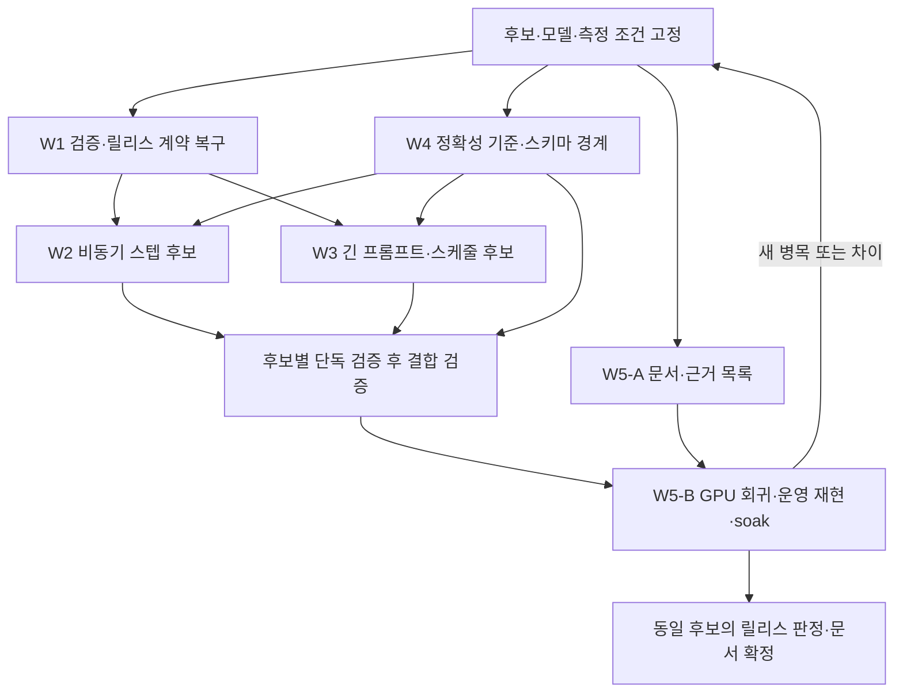

# Riley 개선 종합 계획

작성일 2026-11-13 KST. 초기 기준은 로컬 `main` `37ede4445`와 원격 `origin/main` `9f039de78`이다.

2026-11-20 KST 기준으로 CUDA 빌드·검증을 복구하고 A100의 성능·정확성·운영 결과를 기록했다. jemalloc을 포함한 파생 이미지는 두 모드의 30분 부하에서 정밀 RSS가 `cache-on` 440KiB, `cache-off` 640KiB 줄었다. 같은 이미지의 장문 출력 232건과 성능 대조 출력이 기준과 일치했다. 성능 대조의 사전 회귀 기준은 통과했고 RAG C8 한 seed의 첫 토큰 p95가 12.69% 늘어 기본값 적용과 릴리스를 보류한다. [후보별 검증 근거와 릴리스 판정](06-candidate-qualification.md)

| 작업 | 현재 근거와 다음 검증 |
|---|---|
| W1 검증·릴리스 | Linux Production CPU, 고정 RC3 테스트 34건, CUDA 12.8 네이티브 빌드·Clippy와 CUDA 12.4 이미지 CPU 검증을 통과했다. 현재 배포 입력과 이미지 원본의 해시를 대조했다. [W1 결과](01-validation-result.md) |
| W2 실행 중첩 | `after-submit-v1`은 A100 32행 decode의 커널 공백 중앙값을 51–72µs 줄였고 네 일반 서빙 비교에서 처리량을 0.38–0.89% 높였다. `native-bf16-varlen-v1`의 기존 발행 정책을 유지한다. 정렬된 KV 테이블과 이벤트 복사 제거는 SmolLM2의 단일 iteration에서 채택 이득을 충족하지 못했다. [발행 정책 계측](02-async-step-result.md#발행-정책과-32행-decode-커널-간격) · [두 번째 후보 결과](02-async-step-result.md#커밋된-이벤트-데이터의-복사-제거) |
| W3 장문·스케줄 | Qwen2.5-14B에서 1,024행 QKV 후보는 고정 도착 대조의 첫 토큰 p95를 3.54–12.88% 줄였으나, 같은 형상의 Coder-14B에서는 역순 동시 유입의 decode TPOT이 1.99% 늘어 공통 적용을 기각했다. Qwen2.5-14B의 50ms 유입에서 41번 요청의 prefill 조각 사이 대기는 399ms 늘었고 KV 예약은 한도보다 744블록 여유가 있었다. 장문 경계 11개는 네 chunk·KV 조합의 진단에서 308건의 응답이 토큰 ID까지 일치했다. KV 768블록의 기본 30초 실행은 C32에서 408이 발생했다. [고정 도착 결과](03-long-context-result.md#두-rag-seed의-고정-도착-재생) · [Coder-14B 결과](03-long-context-result.md#coder-14b의-1024행-후보-검증) · [같은 실행의 동시 계측](03-long-context-result.md#같은-실행의-요청-대기와-cuda-커널-대조) · [경계·KV 검증](03-long-context-result.md#장문-chunk와-kv-한도의-교차-대조) |
| W4 정확성·스키마 | 장문 29건의 Riley·HF 첫 분기 7건 중 6건은 decode였다. Riley ID가 단독 최대인 두 사례에서 첫 레이어 QKV를 정확한 HF 행으로 교체해도 선택 토큰과 전체 생성 결과가 같았다. 같은 두 사례의 residual 교체에서 토큰 선택에 영향을 준 첫 경계를 레이어 0의 MLP 이후와 attention 직후로 각각 좁혔다. 첫 prefill 분기의 레이어와 네 모델의 GSM8K·구조화 출력 GPU API도 검증했다. [장문·품질 결과](04-long-accuracy-result.md#실제-bf16-점수-행의-분기-검산) · [순전파 대조](04-long-accuracy-result.md#대체-qkv-행이-최종-decode에-미친-영향) · [스키마 결과](04-structured-output-result.md) · [residual 경계 검증](04-long-accuracy-result.md#residual-경계-교체로-decode-토큰-선택을-재현) · [동일 입력 투영 대조](04-long-accuracy-result.md#같은-입력으로-레이어-0의-mlp와-attention-출력-투영-대조) · [투영 정밀도 검산](04-long-accuracy-result.md#투영의-bf16-반올림과-축소-정밀도-대조) · [실제 GEMM 계획](04-long-accuracy-result.md#실제-riley-계획과-split-k-부분합-정밀도) · [대안의 서빙 재생](04-long-accuracy-result.md#투영-대안을-실제-decode-응답에서-재생) · [행 수 검증](04-long-accuracy-result.md#후보별-21개-배치-행-수-대조) · [계획 31 전체 적용 기각](04-long-accuracy-result.md#계획-31-전체-서빙-대조와-판정) |
| W5 문서·운영 | jemalloc 파생 이미지에서 두 캐시 설정의 30분 부하, 각 API 40건, 종료 자원 회수와 장문 출력 232건을 통과했다. 네 성능 실행에서 총 2,560건이 일치했다. RAG C8 seed 2의 닫힌 부하에서 TTFT p95는 +12.69%였고, 동일한 시각표를 재생한 두 대조에서는 +1.08%와 −2.29%였다. [운영 부하와 회수 절차](05-documentation-and-operations.md#합성-부하의-확인-기준) · [A100 성능 대조](05-mixed-soak-result.md#같은-gpu에서-비교한-서빙-성능) |

## 1. 목표와 현재 위치

Riley 0.1.0의 기본 서빙 기능을 유지하면서, 변경을 신뢰할 수 있는 검증 체계를 먼저 복구하고 남은 성능·정확성 한계를 단계적으로 줄인다. 범위는 앞서 확인한 다섯 개선 항목이다.

초기 조사 당시 로컬 main은 원격보다 9커밋 앞섰고 차이는 재측정 근거와 `docs/goal.md`였다. 이후 W1과 W2를 `main`에 반영했다. 새 측정은 실제 기준 커밋과 바이너리에 각각 결속한다.

현재 구현은 연속 배칭, Paged KV, CUDA Graph, 스트리밍·취소, structured output·tools·logprobs, 8K 문맥, prefix cache, 정적 LoRA 병합, 32B TP=2를 포함한다. 단일 GPU 24개 모델의 qualification과 광범위한 측정 기록이 있다. 이것이 모든 워크로드·모델·장비의 목표 충족을 뜻하지는 않는다.

## 2. 문서별 책임과 연결

| ID | 상세 문서 | 해결할 문제 | 다른 작업에 넘기는 결과 |
|---|---|---|---|
| W1 | [검증·CI·릴리스 계약 복구](01-validation-and-release.md) | 포맷·Clippy 실패, 릴리스 계약과 소스 불일치, 측정 실패 누락 | 재현 가능한 기준 빌드와 신뢰 가능한 판정 도구 |
| W2 | [비동기 스텝과 CPU/GPU 중첩](02-async-step.md) | 스텝 사이 호스트 작업으로 생기는 GPU 유휴 | GPU 기준선, 기존 옵션 비교 및 채택 판단 |
| W3 | [긴 프롬프트와 혼합 부하](03-long-context-and-scheduling.md) | RAG 첫 토큰 지연, p95, prefill과 decode의 상충 | 워크로드별 정책과 성능·지연 비용표 |
| W4 | [장문 정확성과 스키마 계약](04-correctness-and-schema.md) | HF 장문 차이, 스키마 의미의 불완전한 보장 | 수치 변경·스케줄 변경을 판정할 정확성 검사 |
| W5 | [문서·관측·운영 검증](05-documentation-and-operations.md) | 문서 드리프트, 수동 GPU 검증, 실제 트래픽 근거 부족 | 동일 후보에 묶인 문서·운영 근거·릴리스 체크리스트 |

W4는 장문 수치 정확성(W4-A)과 스키마 계약(W4-B)으로 나누어 수행한다. W5도 문서 정리(W5-A), GPU 자동화·운영 검증(W5-B)으로 나누면 장기 작업 때문에 즉시 가능한 정리가 밀리지 않는다.

병렬 조사는 가능하지만 W2와 W3를 동시에 기본값에 반영하지 않는다. 각 후보의 인과관계를 먼저 확인한 뒤 조합한다.

## 3. 초기 기준 조사에서 확인한 항목

| 구분 | 근거와 해석 |
|---|---|
| 로컬 CPU 라이브러리 검사 | Rust 1.85.0, `--workspace --lib --no-default-features --features riley-server/server`: 621건 통과, 1건 ignored. GPU 검증을 포함하지 않는다. |
| 샌드박스 영향 | 최초 실행의 HTTP 테스트 26건은 로컬 포트 바인딩 거부로 실패했다. 해당 제한을 해제한 라이브러리 재실행에서 서버 97건 전부 통과했다. 코드 결함으로 집계하지 않는다. |
| 포맷·린트 | `cargo fmt --check`에서 57개 파일 차이. CI 설정의 Clippy 명령도 실패. 오류 수는 첫 실패 크레이트에 한정되므로 전체 결함 수로 보지 않는다. |
| Python 검증 | Python 3.12 벤치마크 스크립트 테스트 182건: 실패 2, 오류 23. 주요 오류는 서버 기본값 소스 해시 불일치. 성능 파생 계약 드리프트도 확인했다. Python 3.10 실행 결과는 환경이 다르므로 별도 기록한다. |
| 운영 기록 | 0.1.0 후보는 API 40/40, 30분 혼합 soak 14,378건·연결 종료 758건에서 오류·KV 잔류가 없었다. 이번 작업에서 GPU로 다시 실행한 결과는 아니다. |
| 남은 성능 | Coder-14B closed-c32 TPOT, SmolLM2-1.7B reason-c32 처리량, 일부 RAG 최종 목표는 미달하며 기존 운영 규칙에 따라 구조 한계로 닫혔다. |
| 아직 모르는 것 | 비동기 구조의 실제 이득, 장문 HF 차이의 최초 원인, 실제 서비스 트래픽의 지연·취소 분포. 조사 가설과 측정 사실을 분리한다. |

당시 로컬 진단 로그는 `/private/tmp/riley-status-*-20261113.log`에 있다. 임시 로그에만 의존하지 말고 W1에서 필요한 재현 로그·요약을 저장소의 새 근거 디렉터리로 옮긴다. 새 후보 결과로 과거 기록을 덮어쓰지 않는다.

## 4. 진행 순서와 단계별 종료 조건

| 단계 | 수행 내용 | 다음 단계로 넘길 조건 |
|---|---|---|
| M0 기준 고정 | HEAD·바이너리·모델·라이브러리·GPU·실행 옵션·워크로드를 식별 | 동일 입력으로 다시 실행할 수 있는 manifest와 알려진 미달 목록 |
| M1 검증 복구 | W1, W4의 최소 재현·독립 판정기, W5-A | 필수 CPU 검사 통과, 해시 드리프트 정상·오류 경로 검증, 실패한 측정을 성공으로 처리하지 않음 |
| M2 원인 확인 | W2·W3 프로파일, W4-A 첫 분기 토큰·층 추적 | 원인별 근거와 한 번에 하나씩 바꿀 후보 목록. 추정 이득만으로 채택하지 않음 |
| M3 후보 구현 | W2·W3를 각각 opt-in으로 구현, W4-B 계약 수정 | 단독 성능·정확성·수명·오류 처리 검사 통과 |
| M4 결합 검증 | 기준/W2/W3/W2+W3 비교, affected 모델 전부 재검증 | 상호작용·회귀·지원 범위가 명시된 최종 후보 |
| M5 운영·릴리스 | W5-B, 동일 바이너리 API·soak·패키징·문서 확정 | 실패·보류·한계 항목까지 포함한 릴리스 판정서 |

하드웨어가 없어 M2 이후를 실행하지 못하면 M1까지 완료 상태와 필요한 장비·실험을 남긴다. CPU 통과를 GPU 기능 통과로 대체하지 않는다.

## 5. 공통 측정·판정 규칙

기존 [목표와 운영 규칙](../goal.md)을 유지한다. 아래 표의 기존 기준과 신규 제안을 구분한다.

| 항목 | 판정 규칙 |
|---|---|
| 출력·배치 불변성 | 성능 변경은 이전 승인 빌드와 토큰·출력 바이트 동일. 배치 구성·취소 순서를 바꿔도 요청별 출력이 같아야 한다. |
| 수치 변경 | KV 분할·GEMM 기준·reduction 변경은 별도 변경으로 식별한다. 기존 문서의 사전 승인·모델 재검증 절차를 적용한다. 이 계획 작성은 수치 변경 실행 승인이 아니다. |
| 회귀 | 기존 규칙: 짧은 프롬프트 지표 2% 이상, decode TPOT 1% 이상 악화 금지. 개선 목표의 ±3% 동률 규칙과 혼동하지 않는다. |
| 상대 성능 | 처리량은 Riley/vLLM이 높을수록, TTFT·TPOT은 낮을수록 좋다. 분모를 셀에 명시한다. |
| 실행 순서 | Riley/vLLM 교대 `rvvr`를 기본으로 하되 셀별 실제 warm-up·표본 수를 기록한다. `compare.py`의 closed-c1·RAG는 192건 공통 설정이 아니다. |
| 비교 환경 | 모델 revision, 토큰화·BOS/EOS, 정밀도, KV 용량, prefix cache, 문맥·출력 제한, CUDA·cuBLAS, GPU 공유 상태를 맞춘다. 수정된 vLLM 기준선은 기본 기준선과 분리한다. |
| 꼬리 지연 | 작은 RAG 표본은 탐색용이다. 최종 p95 판정은 서로 다른 seed·반복과 충분한 완료 요청 수를 사전 지정해 재측정한다. 평균 p95 하나로 변동을 숨기지 않는다. |
| 종료 | 기존 규칙: 출력 바이트를 지키는 레버 두 개가 각각 2% 미만이면 근거와 함께 현재 구조 한계로 닫는다. 새 구조 가설에 근거가 있을 때만 재개한다. |
| 신규 제안 | 장기 soak·운영 SLO·프로파일 오버헤드·GPU CI 모델 축소 전략은 각 문서의 제안이다. 측정 전에 기준을 확정하고 결과를 보고 낮추지 않는다. |

## 6. 증거를 공유하는 방법

새 작업은 `benchmarks/evidence/<날짜>-improvement/<work-id>/<candidate-id>/` 아래에 둔다. 아래 파일명은 제안하는 산출물이며 현재 구현된 도구·스키마가 아니다.

- `manifest.json`: Git SHA·dirty 여부·source archive SHA·바이너리 SHA·모델 파일 해시·도구 버전·장비·라이브러리·실행 옵션·시간.
- `workload.json`: 입력 ID·seed·입출력 길이·요청 간격·취소·기능 조합·표본 수. 문장 수 대신 실제 토큰 수도 기록.
- `raw/`: 요청별 결과·오류·서버 종료 상태·메트릭·원본 프로파일. 성공한 셀만 추리지 않는다.
- `comparison.json`: 기준/후보 지표·분산·출력 차이·탈락 사유. 현재 판정 도구를 변경할 때는 W1의 계약을 함께 갱신.
- `decision.md`: 채택/opt-in 유지/기각/구조 한계/미검증, 근거 링크와 다음 작업.

W1은 manifest와 실패 판정을 제공한다. W4는 같은 입력 ID의 정확성 판정을 제공한다. W2·W3는 같은 후보 ID로 성능·실행 경로를 붙인다. W5는 이 결과를 사용자 문서와 운영 검증에 연결한다. 서로 다른 빌드의 좋은 결과만 조합해 하나의 릴리스 근거로 쓰지 않는다.

[후보 검증 근거와 릴리스 판정](06-candidate-qualification.md)에서 실제로 확인한 바이너리·이미지와 남은 출시 조건을 확인할 수 있다.

## 7. 변경 묶음과 회수 방법

1. W1의 린트·계약 복구와 W5-A의 문서 정리는 실행 동작 변경과 분리한다. 포맷이 해시 결속 소스를 바꾼다는 점도 검토 기록에 남긴다.
2. W4-B의 스키마 계약 수정은 API 동작 변경으로 별도 검토한다. 지원 범위를 줄이는 경우 오류 코드와 이전 요청의 영향을 문서화한다.
3. W2·W3는 각각 기존 경로로 돌아갈 수 있는 opt-in 후보로 시작한다. 토글 이름·기본값은 구현 전 설계에서 확정한다.
4. 수치 변경이 필요하면 성능 구조 변경과 분리해 품질·모델 재검증 범위를 명시한다.
5. 최종 소스·계약을 고정하고 그 후보로 패키지·정확성·성능·soak를 수행한다. 이후 소스가 바뀌면 영향 범위에 따라 필요한 검사를 다시 실행한다.

## 8. 종합 완료 체크리스트

- [x] W1 로컬: CPU 검사와 릴리스·성능 계약의 정상/드리프트 경로가 통과한다([결과](01-validation-result.md)).
- [x] W1 CI: Linux hosted workflow의 본 검사와 Linux 전용 항목을 통과했다. [실행 결과](01-validation-result.md)
- [x] W1 CI: 과거 RC3의 고정 Python·경로를 재현한 Linux 컨테이너에서 34건을 통과했다. [실행 결과](01-validation-result.md#과거-rc3-고정-테스트의-실제-실행)
- [x] W4: 장문 차이의 입력·최초 분기 토큰·첫 BF16 불일치와 남은 불확실성을 기록했다. [장문 검증](04-long-accuracy-result.md#첫-prefill-분기-추적)
- [x] W4: 투영 대안 두 개를 장문 29개의 실제 서빙에서 대조했다. 둘 다 배치 불변성을 유지했고 HF 전체 생성 일치가 기준 22/29에서 각각 18/29와 19/29로 줄어 기각했다. [Attention 출력](04-long-accuracy-result.md#계획-31-전체-서빙-대조와-판정) · [FP32 부분합 down projection](04-long-accuracy-result.md#fp32-부분합을-적용한-down-projection-전체-서빙-판정)
- [x] W4: 문서화한 스키마 부분집합을 독립 판정과 대조하고, 미지원 제약의 오류를 검증했다. [스키마 검증](04-structured-output-result.md)
- [x] W2: 마지막 출력 전달 전에 취소됐을 때 정상 완료가 전달되는 결함을 수정했다. 두 발행 모드의 CPU 회귀 검사와 A100 API·취소·종료 부하를 통과했다. [취소·종료 검증](02-async-step-result.md#마지막-토큰-전달과-취소의-순서)
- [ ] W2·W3: 단독·결합 결과에서 기존 정확성·회귀 가드레일을 충족한다. W2의 단일 iteration 후보들은 처리량 이득이 재현되지 않아 미채택했고, W3의 1,024행 QKV 형상 공통 적용은 Coder-14B decode 회귀로 기각했다. [W2 다운로드 완료 확인 대조](02-async-step-result.md#결과-다운로드의-cuda-완료-확인-통합) · [W3 Coder-14B 결과](03-long-context-result.md#coder-14b의-1024행-후보-검증)
- [x] W5: 대상 GPU에서 배포 이미지의 실제 추론과 cache-on·off 30분 부하 증거를 확보했다. [운영 결과와 판정](05-mixed-soak-result.md#배포-이미지의-혼합-부하)
- [x] W5: 배포 이미지의 45초 smoke에서 2-KV-head GQA·Qwen3·MHA·14B의 API 계약, 혼합 부하·취소·종료 회수를 검증했다. [MHA·14B 결과](05-mixed-soak-result.md#배포-이미지의-mha와-14b-smoke) [대표 모델 결과](05-mixed-soak-result.md#배포-이미지의-대표-모델-45초-smoke)
- [x] W5: 배포 이미지에서 prefill과 decode를 함께 포함한 커밋된 GPU iteration 36개를 관측하고, 단독·혼합 응답의 토큰 ID와 종료 계약을 대조했다. [혼합 iteration 결과](05-mixed-soak-result.md#배포-이미지의-커밋된-혼합-gpu-iteration)
- [x] W5: 배포 이미지의 Qwen2.5-32B TP=2에서 API 40건을 통과하고 C8·C32 응답 43건이 C1 기준과 일치했다. [32B TP=2 결과](05-mixed-soak-result.md#배포-이미지의-32b-tp2-장문-검증)
- [x] W5: 같은 이미지 두 개의 닫힌 RAG C8 3,072건에서 출력 일치와 seed별 꼬리 지연을 확인했다. Seed 2의 지연 증가가 반복됐다. [닫힌 RAG 확장 대조](05-mixed-soak-result.md#닫힌-rag-세-seed의-확장-교차-대조)
- [ ] W5: 릴리스 대상 이미지에서 두 캐시 설정의 RSS 증가 0 운영 기준을 충족한다. 파생 시험 이미지 `1fc444b1840e`에서 두 설정이 통과했으며 최종 릴리스 판정이 남아 있다. [후보 판정](05-mixed-soak-result.md#즉시-반환-설정의-할당기-대조)
- [x] 문서에서 버전·기본값·성능 주장을 해당 버전과 실행 설정에 연결했다. CI는 배포 이미지의 여섯 모델 검증을 같은 이미지·바이너리와 공개 지원 표에 연결한다. [문서 대조](05-documentation-and-operations.md#w5-a3-반복-가능한-문서-검증) · [배포 이미지 지원 표](../model-support.md#packaged-serving-checks)
- [ ] 목표 미달을 숫자상 해결과 구분해 명시하고, 기본값·opt-in·미지원 범위를 확정했다.

본 계획에서 MoE·양자화·비전·다중 호스트·런타임 LoRA 전환을 새로 구현하지 않는다. 현재 범위의 신뢰성과 병목을 해결한 뒤 별도 로드맵으로 평가한다.

## 9. 기준 자료

- [0.1.0 변경 기록](../../CHANGELOG.md)
- [목표·가드레일·구조 한계 판정](../goal.md)
- [서빙 검증](../serving-validation.md)
- [18개 모델 최신 비교](../../benchmarks/evidence/20261104-goal/full16-table.md)
- [24개 모델 최신 RAG 비교](../../benchmarks/evidence/20261104-goal/stage1t16-table.md)
