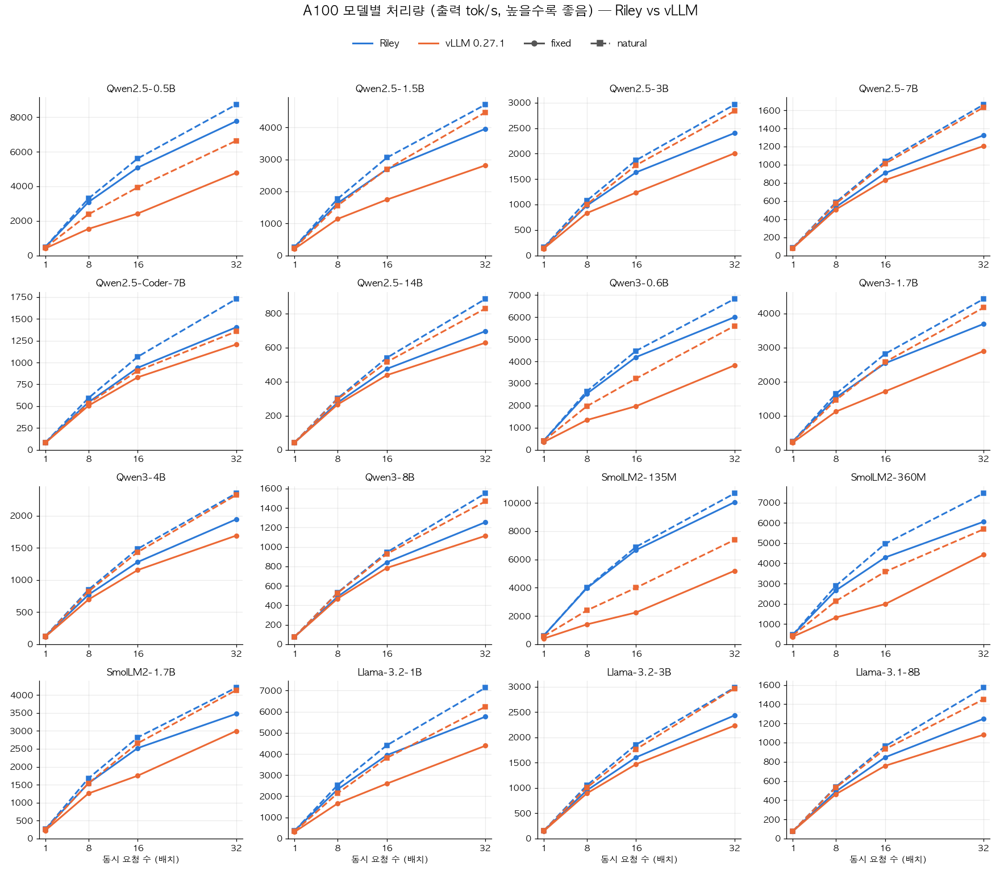
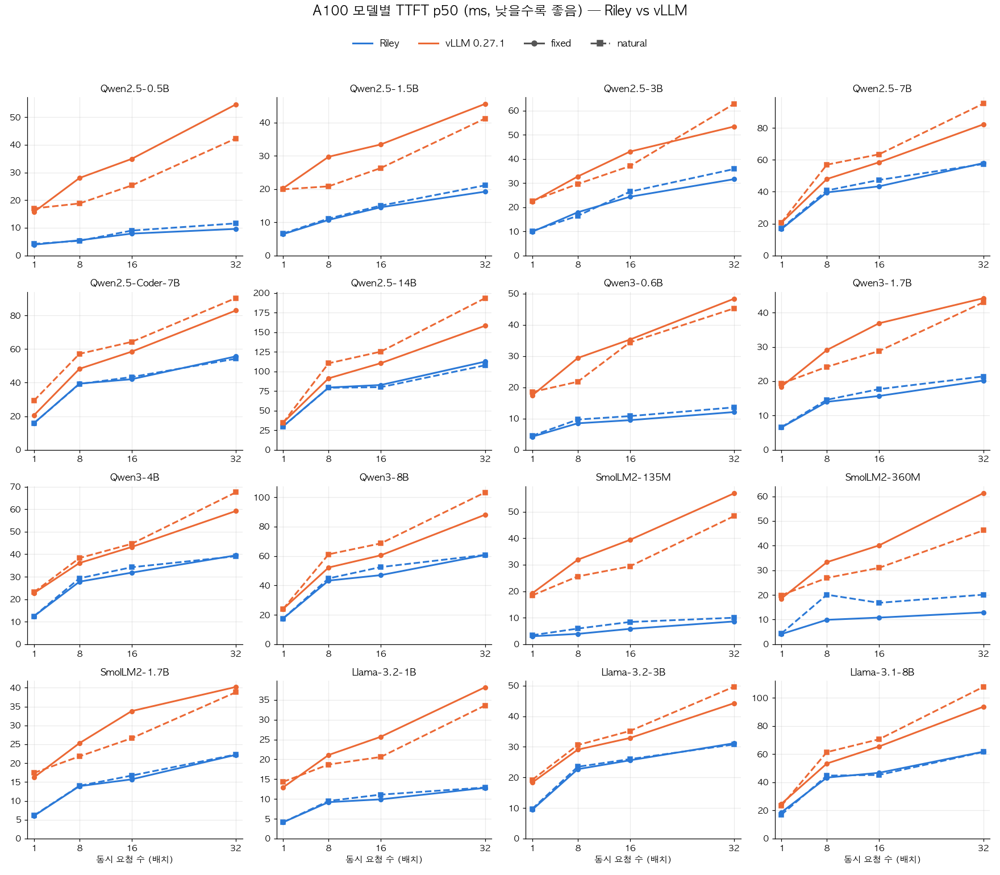
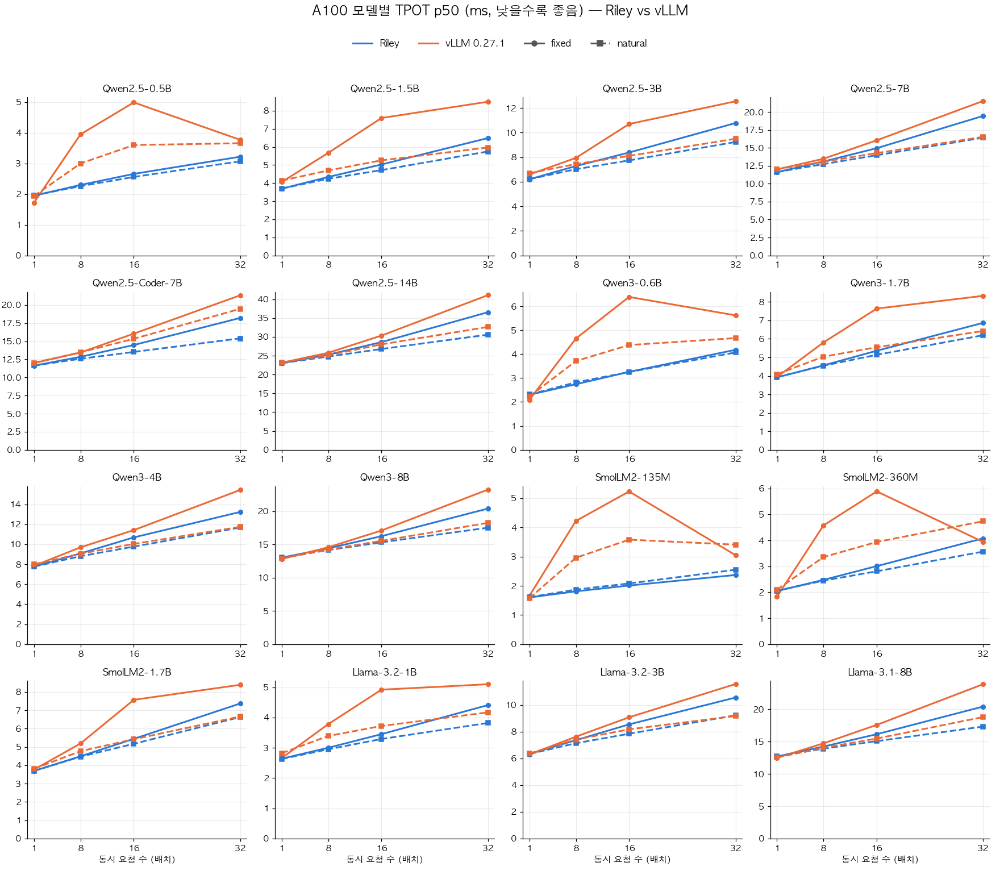
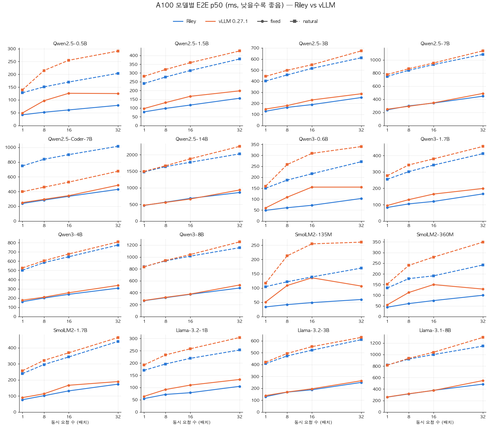

# A100 모델별 성능 비교 (Riley vs vLLM 0.27.1)

[성능표](model-coverage-a100-perf-table.md)의 지표별 표 네 개를 모델 기준으로 합친 것이다. 측정 조건과 출처는 원본 문서를 따른다. 각 칸은 **Riley / vLLM** 값이다.

## 그래프

x축은 동시 요청 수(1, 8, 16, 32), 파랑은 Riley, 주황은 vLLM이다. 실선은 fixed, 점선은 natural 워크로드다. 모델마다 y축 범위가 다르다.

### 처리량 (출력 tok/s, 높을수록 좋음)

### TTFT p50 (ms, 낮을수록 좋음)

### TPOT p50 (ms, 낮을수록 좋음)

### E2E p50 (ms, 낮을수록 좋음)

## 표

| 모델 | 셀 | 처리량 tok/s (R / V) | TTFT ms (R / V) | TPOT ms (R / V) | E2E ms (R / V) |
|---|---|---:|---:|---:|---:|
| Qwen2.5-0.5B | c1-fixed | 486 / 411 | 3.9 / 15.7 | 1.95 / 1.72 | 42 / 49 |
|  | c1-natural | 492 / 460 | 4.2 / 17.0 | 1.96 / 1.94 | 128 / 139 |
|  | c8-fixed | 3089 / 1538 | 5.5 / 28.0 | 2.30 / 3.95 | 52 / 97 |
|  | c8-natural | 3293 / 2378 | 5.3 / 18.8 | 2.26 / 3.00 | 151 / 215 |
|  | c16-fixed | 5084 / 2426 | 7.9 / 34.9 | 2.66 / 4.99 | 61 / 126 |
|  | c16-natural | 5610 / 3942 | 9.0 / 25.3 | 2.56 / 3.60 | 170 / 255 |
|  | c32-fixed | 7767 / 4780 | 9.6 / 54.6 | 3.22 / 3.77 | 79 / 125 |
|  | c32-natural | 8728 / 6637 | 11.6 / 42.3 | 3.07 / 3.66 | 204 / 291 |
| Qwen2.5-1.5B | c1-fixed | 260 / 206 | 6.4 / 20.2 | 3.69 / 4.06 | 78 / 97 |
|  | c1-natural | 263 / 229 | 6.6 / 19.9 | 3.70 / 4.14 | 240 / 281 |
|  | c8-fixed | 1635 / 1141 | 10.7 / 29.7 | 4.34 / 5.67 | 98 / 131 |
|  | c8-natural | 1770 / 1560 | 11.1 / 20.8 | 4.24 / 4.70 | 277 / 320 |
|  | c16-fixed | 2694 / 1745 | 14.5 / 33.4 | 5.03 / 7.60 | 117 / 167 |
|  | c16-natural | 3057 / 2700 | 15.0 / 26.3 | 4.72 / 5.26 | 314 / 359 |
|  | c32-fixed | 3957 / 2816 | 19.2 / 45.6 | 6.49 / 8.50 | 156 / 198 |
|  | c32-natural | 4714 / 4474 | 21.1 / 41.2 | 5.75 / 5.97 | 380 / 426 |
| Qwen2.5-3B | c1-fixed | 156 / 135 | 9.8 / 22.3 | 6.20 / 6.59 | 129 / 149 |
|  | c1-natural | 158 / 144 | 10.1 / 22.6 | 6.21 / 6.70 | 402 / 444 |
|  | c8-fixed | 978 / 831 | 17.9 / 32.7 | 7.28 / 7.94 | 164 / 180 |
|  | c8-natural | 1075 / 1000 | 16.4 / 29.6 | 7.02 / 7.44 | 457 / 499 |
|  | c16-fixed | 1631 / 1234 | 24.3 / 43.0 | 8.38 / 10.70 | 189 / 231 |
|  | c16-natural | 1869 / 1772 | 26.4 / 37.0 | 7.74 / 8.11 | 516 / 549 |
|  | c32-fixed | 2403 / 2006 | 31.6 / 53.4 | 10.78 / 12.55 | 253 / 287 |
|  | c32-natural | 2962 / 2835 | 35.8 / 62.8 | 9.24 / 9.50 | 612 / 674 |
| Qwen2.5-7B | c1-fixed | 84 / 80 | 16.5 / 20.5 | 11.61 / 11.99 | 239 / 249 |
|  | c1-natural | 84 / 82 | 16.9 / 20.6 | 11.62 / 12.02 | 749 / 778 |
|  | c8-fixed | 534 / 507 | 39.6 / 48.0 | 13.09 / 13.48 | 300 / 294 |
|  | c8-natural | 587 / 572 | 40.8 / 57.0 | 12.73 / 13.06 | 843 / 867 |
|  | c16-fixed | 909 / 831 | 43.4 / 58.5 | 14.95 / 16.05 | 343 / 346 |
|  | c16-natural | 1037 / 1012 | 47.4 / 63.5 | 13.97 / 14.27 | 930 / 954 |
|  | c32-fixed | 1325 / 1206 | 58.0 / 82.3 | 19.45 / 21.53 | 448 / 490 |
|  | c32-natural | 1663 / 1633 | 57.4 / 95.3 | 16.41 / 16.52 | 1086 / 1140 |
| Qwen2.5-Coder-7B | c1-fixed | 84 / 80 | 15.8 / 20.5 | 11.63 / 11.99 | 239 / 251 |
|  | c1-natural | 84 / 80 | 15.8 / 29.2 | 11.64 / 12.02 | 749 / 399 |
|  | c8-fixed | 545 / 506 | 39.4 / 48.2 | 12.85 / 13.45 | 285 / 295 |
|  | c8-natural | 593 / 532 | 39.2 / 57.1 | 12.58 / 13.47 | 839 / 460 |
|  | c16-fixed | 940 / 831 | 42.0 / 58.4 | 14.48 / 16.05 | 336 / 345 |
|  | c16-natural | 1066 / 905 | 43.3 / 64.2 | 13.52 / 15.34 | 902 / 529 |
|  | c32-fixed | 1404 / 1207 | 55.6 / 82.9 | 18.22 / 21.35 | 431 / 487 |
|  | c32-natural | 1728 / 1355 | 54.2 / 90.3 | 15.40 / 19.48 | 1016 / 677 |
| Qwen2.5-14B | c1-fixed | 43 / 42 | 29.9 / 34.6 | 23.01 / 23.14 | 470 / 477 |
|  | c1-natural | 43 / 43 | 29.8 / 34.4 | 23.03 / 23.20 | 1481 / 1496 |
|  | c8-fixed | 277 / 266 | 79.5 / 91.2 | 25.28 / 25.78 | 570 / 563 |
|  | c8-natural | 302 / 297 | 79.2 / 110.4 | 24.78 / 25.12 | 1641 / 1668 |
|  | c16-fixed | 475 / 438 | 82.7 / 110.5 | 28.62 / 30.35 | 684 / 665 |
|  | c16-natural | 540 / 515 | 79.9 / 125.2 | 26.79 / 28.02 | 1773 / 1878 |
|  | c32-fixed | 696 / 628 | 112.5 / 158.2 | 36.56 / 41.09 | 862 / 938 |
|  | c32-natural | 885 / 829 | 107.8 / 193.4 | 30.60 / 32.65 | 2026 / 2253 |
| Qwen3-0.6B | c1-fixed | 416 / 349 | 4.2 / 17.4 | 2.30 / 2.08 | 49 / 60 |
|  | c1-natural | 406 / 407 | 4.5 / 18.5 | 2.31 / 2.23 | 150 / 159 |
|  | c8-fixed | 2536 / 1345 | 8.5 / 29.4 | 2.74 / 4.65 | 61 / 109 |
|  | c8-natural | 2645 / 1969 | 9.7 / 21.8 | 2.82 / 3.71 | 187 / 258 |
|  | c16-fixed | 4193 / 1974 | 9.5 / 35.3 | 3.26 / 6.39 | 72 / 155 |
|  | c16-natural | 4475 / 3222 | 10.8 / 34.4 | 3.25 / 4.38 | 216 / 309 |
|  | c32-fixed | 5999 / 3821 | 12.1 / 48.4 | 4.18 / 5.62 | 103 / 155 |
|  | c32-natural | 6824 / 5603 | 13.6 / 45.3 | 4.07 / 4.67 | 271 / 340 |
| Qwen3-1.7B | c1-fixed | 246 / 214 | 6.5 / 18.4 | 3.92 / 3.94 | 83 / 95 |
|  | c1-natural | 244 / 232 | 6.6 / 19.3 | 3.93 / 4.09 | 255 / 277 |
|  | c8-fixed | 1532 / 1121 | 14.0 / 29.1 | 4.57 / 5.81 | 105 / 131 |
|  | c8-natural | 1641 / 1460 | 14.6 / 24.2 | 4.55 / 5.04 | 302 / 343 |
|  | c16-fixed | 2539 / 1714 | 15.7 / 36.9 | 5.36 / 7.64 | 120 / 165 |
|  | c16-natural | 2814 / 2575 | 17.7 / 28.8 | 5.14 / 5.55 | 342 / 380 |
|  | c32-fixed | 3693 / 2897 | 20.2 / 44.2 | 6.87 / 8.33 | 166 / 199 |
|  | c32-natural | 4424 / 4170 | 21.4 / 43.0 | 6.20 / 6.43 | 412 / 456 |
| Qwen3-4B | c1-fixed | 125 / 116 | 12.4 / 22.7 | 7.76 / 7.85 | 161 / 177 |
|  | c1-natural | 125 / 121 | 12.4 / 23.1 | 7.77 / 8.00 | 502 / 527 |
|  | c8-fixed | 771 / 696 | 27.8 / 36.1 | 9.09 / 9.70 | 201 / 210 |
|  | c8-natural | 850 / 822 | 29.3 / 38.3 | 8.81 / 9.06 | 585 / 605 |
|  | c16-fixed | 1281 / 1156 | 31.8 / 43.2 | 10.69 / 11.42 | 241 / 258 |
|  | c16-natural | 1487 / 1436 | 34.2 / 44.6 | 9.77 / 10.04 | 648 / 678 |
|  | c32-fixed | 1947 / 1693 | 39.5 / 59.2 | 13.24 / 15.44 | 308 / 338 |
|  | c32-natural | 2352 / 2325 | 39.1 / 67.5 | 11.68 / 11.75 | 775 / 809 |
| Qwen3-8B | c1-fixed | 75 / 75 | 17.4 / 23.9 | 13.00 / 12.80 | 267 / 270 |
|  | c1-natural | 75 / 76 | 17.5 / 23.9 | 13.01 / 12.90 | 837 / 835 |
|  | c8-fixed | 489 / 469 | 43.3 / 52.2 | 14.41 / 14.56 | 317 / 323 |
|  | c8-natural | 530 / 526 | 44.8 / 61.2 | 14.14 / 14.21 | 936 / 942 |
|  | c16-fixed | 842 / 784 | 47.0 / 60.5 | 16.23 / 17.08 | 374 / 378 |
|  | c16-natural | 945 / 928 | 52.5 / 68.6 | 15.31 / 15.53 | 1015 / 1042 |
|  | c32-fixed | 1254 / 1114 | 60.7 / 88.1 | 20.38 / 23.23 | 480 / 531 |
|  | c32-natural | 1551 / 1468 | 60.8 / 103.3 | 17.50 / 18.23 | 1157 / 1255 |
| SmolLM2-135M | c1-fixed | 597 / 399 | 3.0 / 19.2 | 1.60 / 1.65 | 34 / 51 |
|  | c1-natural | 601 / 554 | 3.4 / 18.4 | 1.61 / 1.57 | 105 / 117 |
|  | c8-fixed | 3959 / 1399 | 3.9 / 31.9 | 1.81 / 4.22 | 42 / 109 |
|  | c8-natural | 4002 / 2388 | 5.9 / 25.6 | 1.87 / 2.96 | 122 / 213 |
|  | c16-fixed | 6662 / 2243 | 5.8 / 39.4 | 2.01 / 5.23 | 49 / 136 |
|  | c16-natural | 6885 / 3993 | 8.4 / 29.4 | 2.08 / 3.58 | 139 / 255 |
|  | c32-fixed | 10048 / 5194 | 8.6 / 57.0 | 2.37 / 3.05 | 60 / 107 |
|  | c32-natural | 10670 / 7382 | 10.0 / 48.4 | 2.55 / 3.41 | 170 / 261 |
| SmolLM2-360M | c1-fixed | 462 / 373 | 4.1 / 18.5 | 2.05 / 1.83 | 44 / 55 |
|  | c1-natural | 469 / 426 | 4.3 / 19.9 | 2.06 / 2.10 | 134 / 152 |
|  | c8-fixed | 2661 / 1320 | 9.9 / 33.3 | 2.48 / 4.58 | 61 / 113 |
|  | c8-natural | 2890 / 2134 | 20.1 / 26.9 | 2.45 / 3.36 | 178 / 240 |
|  | c16-fixed | 4291 / 1984 | 10.8 / 40.1 | 3.01 / 5.89 | 75 / 150 |
|  | c16-natural | 4965 / 3585 | 16.8 / 31.0 | 2.81 / 3.94 | 191 / 279 |
|  | c32-fixed | 6058 / 4429 | 12.9 / 61.3 | 4.08 / 3.94 | 100 / 129 |
|  | c32-natural | 7462 / 5686 | 20.1 / 46.2 | 3.57 / 4.74 | 242 / 349 |
| SmolLM2-1.7B | c1-fixed | 262 / 227 | 6.0 / 16.2 | 3.69 / 3.76 | 77 / 90 |
|  | c1-natural | 262 / 247 | 6.1 / 17.4 | 3.69 / 3.81 | 239 / 257 |
|  | c8-fixed | 1541 / 1257 | 13.9 / 25.3 | 4.49 / 5.19 | 102 / 114 |
|  | c8-natural | 1678 / 1541 | 14.0 / 21.8 | 4.47 / 4.77 | 296 / 322 |
|  | c16-fixed | 2520 / 1751 | 15.7 / 33.8 | 5.44 / 7.57 | 132 / 167 |
|  | c16-natural | 2818 / 2656 | 16.7 / 26.6 | 5.17 / 5.42 | 343 / 369 |
|  | c32-fixed | 3475 / 2997 | 22.2 / 40.2 | 7.37 / 8.39 | 174 / 190 |
|  | c32-natural | 4204 / 4134 | 22.3 / 38.8 | 6.63 / 6.66 | 440 / 464 |
| Llama-3.2-1B | c1-fixed | 368 / 313 | 4.1 / 12.9 | 2.64 / 2.66 | 55 / 64 |
|  | c1-natural | 368 / 335 | 4.1 / 14.3 | 2.63 / 2.82 | 170 / 192 |
|  | c8-fixed | 2329 / 1661 | 9.2 / 21.1 | 3.00 / 3.78 | 72 / 92 |
|  | c8-natural | 2532 / 2144 | 9.5 / 18.7 | 2.95 / 3.39 | 196 / 233 |
|  | c16-fixed | 3947 / 2600 | 9.9 / 25.7 | 3.45 / 4.92 | 79 / 110 |
|  | c16-natural | 4414 / 3816 | 11.1 / 20.6 | 3.29 / 3.72 | 219 / 258 |
|  | c32-fixed | 5767 / 4393 | 12.8 / 38.2 | 4.41 / 5.10 | 105 / 133 |
|  | c32-natural | 7138 / 6237 | 12.9 / 33.6 | 3.82 / 4.17 | 253 / 304 |
| Llama-3.2-3B | c1-fixed | 154 / 145 | 9.4 / 18.3 | 6.33 / 6.29 | 130 / 139 |
|  | c1-natural | 154 / 152 | 9.7 / 19.2 | 6.33 / 6.36 | 408 / 420 |
|  | c8-fixed | 951 / 892 | 22.7 / 29.1 | 7.36 / 7.62 | 168 / 169 |
|  | c8-natural | 1050 / 1007 | 23.5 / 30.6 | 7.13 / 7.41 | 473 / 494 |
|  | c16-fixed | 1606 / 1470 | 25.6 / 32.9 | 8.54 / 9.07 | 188 / 196 |
|  | c16-natural | 1855 / 1766 | 26.0 / 35.2 | 7.84 / 8.17 | 521 / 551 |
|  | c32-fixed | 2435 / 2232 | 31.2 / 44.3 | 10.55 / 11.56 | 250 / 264 |
|  | c32-natural | 2983 / 2967 | 30.8 / 49.7 | 9.22 / 9.17 | 610 / 629 |
| Llama-3.1-8B | c1-fixed | 77 / 76 | 18.6 / 24.6 | 12.70 / 12.49 | 260 / 262 |
|  | c1-natural | 77 / 78 | 16.9 / 23.2 | 12.71 / 12.55 | 818 / 814 |
|  | c8-fixed | 491 / 463 | 43.3 / 53.3 | 14.24 / 14.74 | 316 / 319 |
|  | c8-natural | 539 / 531 | 44.7 / 61.4 | 13.91 / 14.04 | 922 / 934 |
|  | c16-fixed | 847 / 758 | 46.7 / 65.4 | 16.15 / 17.59 | 378 / 376 |
|  | c16-natural | 962 / 932 | 45.2 / 70.5 | 15.08 / 15.48 | 1000 / 1040 |
|  | c32-fixed | 1248 / 1082 | 61.7 / 93.6 | 20.43 / 23.89 | 486 / 548 |
|  | c32-natural | 1572 / 1451 | 61.5 / 107.7 | 17.33 / 18.81 | 1147 / 1298 |
